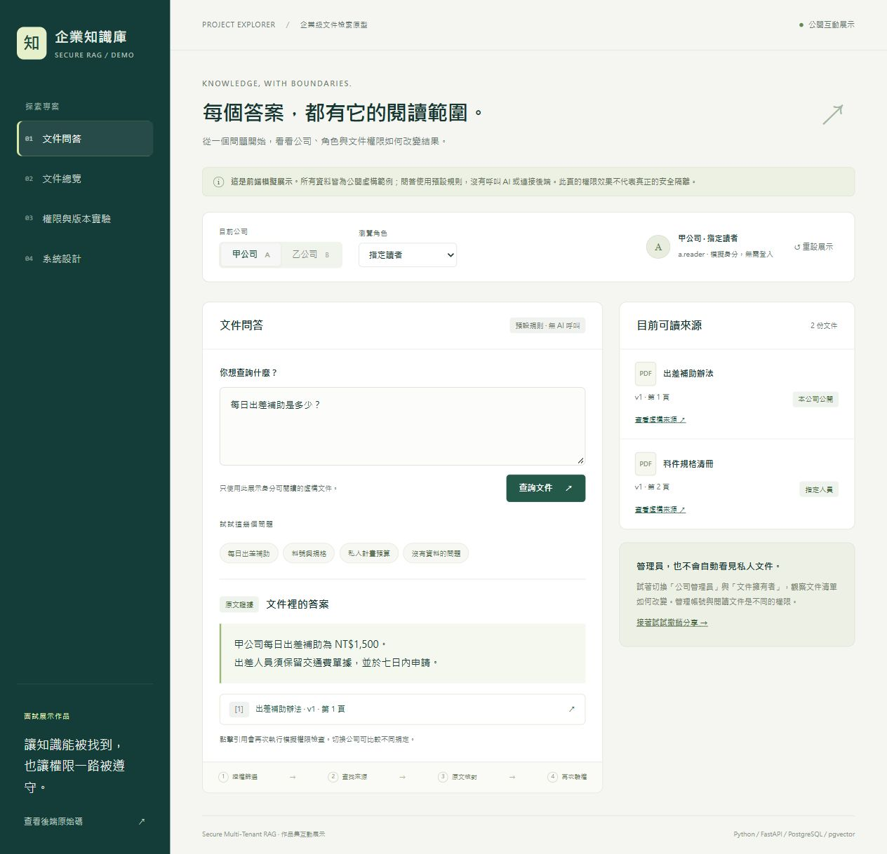
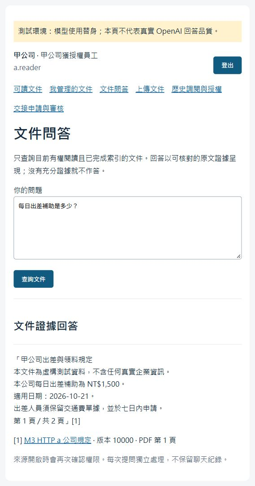
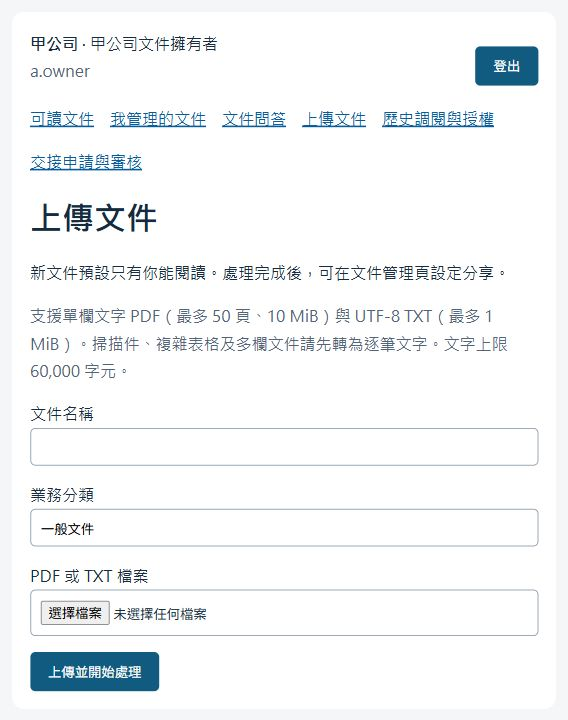
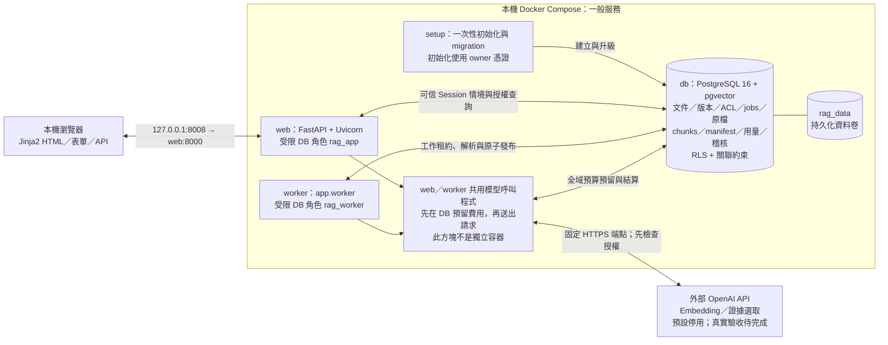
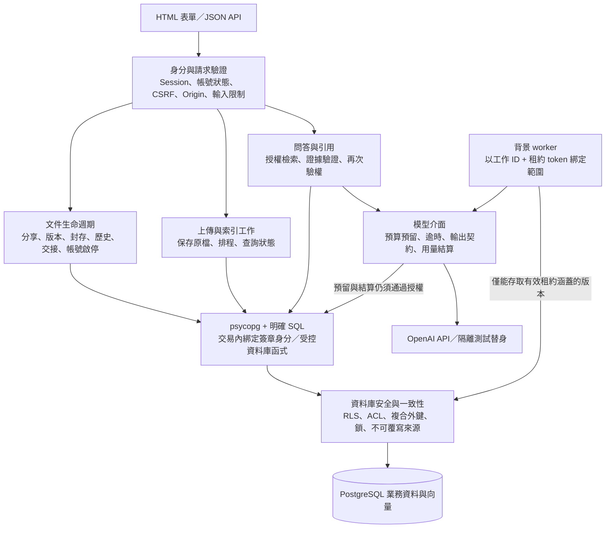
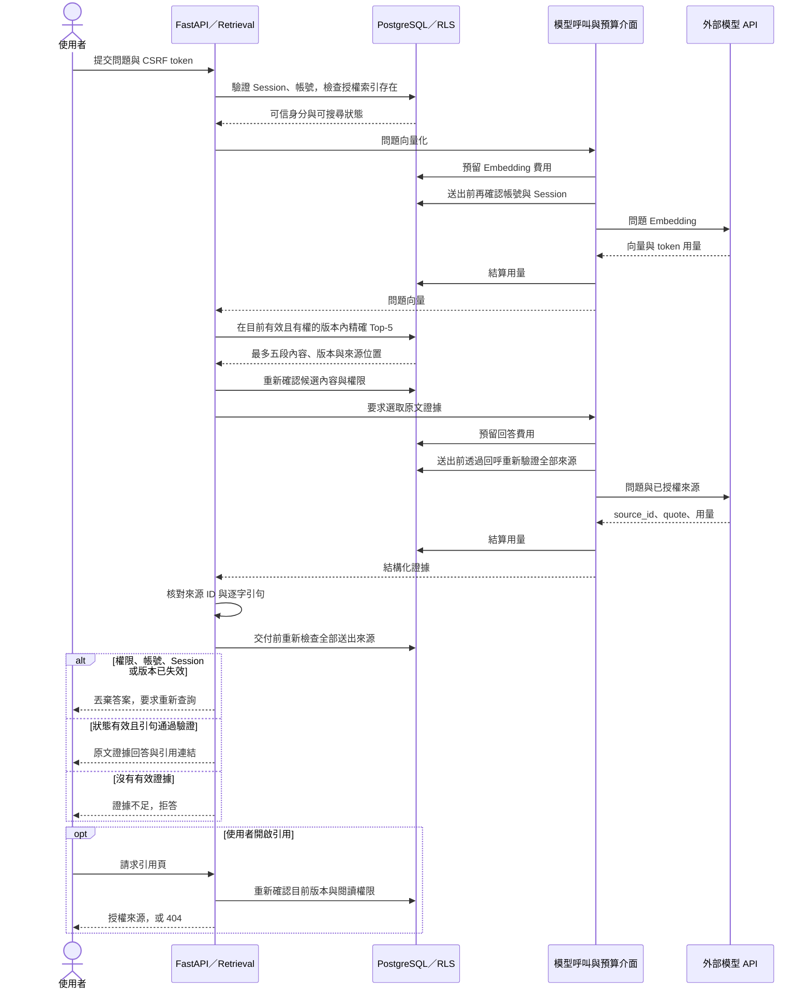
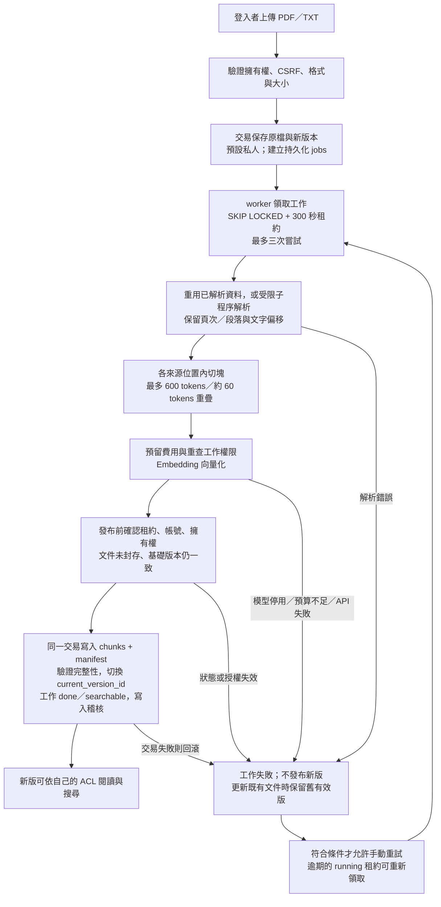
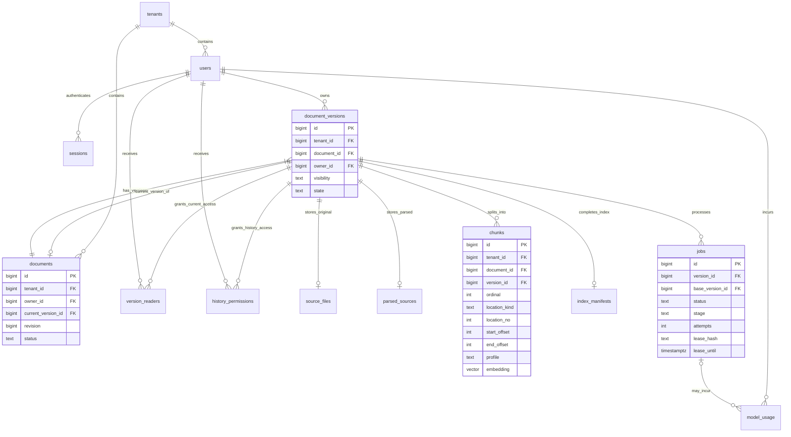

# Secure Multi-Tenant RAG

提供多家公司共用、依公司與文件權限隔離的繁體中文知識查詢平台。處理作業規定、技令手冊、料件清冊等知識資料，完成盤點、解析、清洗、切塊、向量化、檢索及帶來源引用的回答，並用實驗與安全測試驗證結果。

**公開互動 Demo：[開啟企業知識庫展示](https://secure-rag-interview-demo.ruru0109lee.chatgpt.site)**。無需登入，電腦關機也可由面試官開啟。使用公開虛構資料與前端規則模擬，不呼叫 AI，也不代表完整 Python／PostgreSQL 後端已上線。

**文件更新：2026-10-28；功能驗收基準：2026-10-21。M1 / M2 已完成。M3 的 PDF／TXT、來源切塊、pgvector、RAG、引用驗權與預算閘門已實作，既有紀錄為 140 項自動化及 46 次隔離 HTTP 檢查通過。真實 OpenAI 小額驗收仍待完成，不能把替身測試視為模型品質驗收。** 本次文件更新未重跑上述測試；部署現況見下方。完整業務決策與取捨見 [專案決策稿](docs/secure-multi-tenant-rag-decision-draft.md)。決策稿記錄規劃當時的狀態，實作進度以本 README 與實際測試報告為準。

**組員認領入口：[GitHub 任務總索引 #1](https://github.com/mina201199/secure-multi-tenant-rag/issues/1)**。原始 67 項待辦已各自建立 Issue（本機完成狀態見下方清單；遠端 Issue 狀態尚未同步），依 7 個階段的 [Milestones](https://github.com/mina201199/secure-multi-tenant-rag/milestones) 與 `phase:*` 標籤分類。每項包含前置任務、完成條件與認領方式；請先看索引的起步建議，留言認領並由 Assignees 追蹤負責人。功能驗收後再關閉 Issue，並同步更新本文件勾選狀態。

## 目錄

- [部署狀態與展示範圍](#部署狀態與展示範圍)
- [面試介紹與展示腳本](#面試介紹與展示腳本)
- [面試常見問答](#面試常見問答)
- [組員快速接手](#組員快速接手)
- [目前進度與接手順序](#目前進度與接手順序)
- [目標與第一版範圍](#目標與第一版範圍)
- [架構與資料流](#架構與資料流)
- [技術框架與相依套件](#技術框架與相依套件)
- [目前目錄與已知啟動缺口](#目前目錄與已知啟動缺口)
- [環境與啟動方式](#環境與啟動方式)
- [必須遵守的權限與業務規則](#必須遵守的權限與業務規則)
- [資料模型與資料庫設計任務](#資料模型與資料庫設計任務)
- [預計的 API 與頁面契約](#預計的-api-與頁面契約)
- [完整開發任務清單](#完整開發任務清單)
- [測試與驗收](#測試與驗收)
- [分工與協作方式](#分工與協作方式)
- [後續擴充與未定細節](#後續擴充與未定細節)
- [最終交付清單](#最終交付清單)

## 部署狀態與展示範圍

**公開靜態互動 Demo 已於 2026-10-28 發布；完整後端已有本機 Docker Compose 部署配置與先前驗收紀錄，尚未完成正式對外部署。** 公開展示、容器化、後端此刻在線、真實 AI 可用及正式產品上線是不同的驗收項目。

| 項目 | 可確認的狀態 | 證據與限制 |
| --- | --- | --- |
| 公開互動 Demo | **已發布，可匿名開啟** | [展示網址](https://secure-rag-interview-demo.ruru0109lee.chatgpt.site)；Sites 雲端靜態託管，無本機連線依賴。已以無 Cookie 請求取得 200 並確認 Demo HTML |
| 本機部署配置 | 已有 Dockerfile、Compose、初始化與 migration、資料卷、db／web 健康檢查 | 2026-10-28 執行 `docker compose config --quiet` 通過；只代表配置可解析 |
| 過往本機啟動 | 2026-10-21 驗收記錄顯示 db／web 健康、setup 成功、worker 運行 | 見 [M3 驗收紀錄](docs/milestone-3-verification.md)，不是即時監控結果 |
| 本次服務在線狀態 | **未確認** | 2026-10-28 `docker compose ps -a` 無法連線 `desktop-linux` 的 Docker Engine，錯誤為找不到 `dockerDesktopLinuxEngine` 管道；可能是引擎未啟動或 context 不可用，未據此宣稱程式故障 |
| 登入、閱讀與權限管理 | 已實作並有既有驗收 | Docker 與服務正常啟動後可展示，不需要真實模型 |
| 真實 AI 問答 | **尚未完成驗收** | 預設 `OPENAI_ENABLED=false`；真實金鑰、模型可用性、當時費率與品質仍需驗證 |
| 完整後端正式環境 | **儲存庫沒有完成證據** | 原應用 Compose 只將 web 綁定 `127.0.0.1:8008`；沒有已驗收的完整後端雲端部署。公開 Demo 的 HTTPS 網址僅服務靜態展示 |
| 自動化 CI／正式維運 | 待完成 | 本機測試指令已提供；儲存庫未提供 CI 工作流程，備份還原演練、監控告警與正式發布／回退仍待規劃 |

面試可說：「這個網址是公開互動展示，用虛構資料說明權限與版本情境；實際後端有本機容器化環境和流程／權限驗收紀錄，完整後端正式部署與真實模型品質評估尚未完成。」不要說已在企業正式上線、已支援大量使用者或已驗證模型準確率。

公開 Demo 不需要 Docker 或本機服務。若要展示原應用後端，請先啟動 Docker Desktop 的 Linux engine，再按[組員快速接手](#組員快速接手)執行建置與健康檢查。本次公開的是靜態展示，沒有啟用原應用的模型金鑰或進行付費 AI 呼叫。完整後端正式部署還需要更換示範帳密與密鑰、HTTPS／Secure Cookie、正式環境設定、備份與還原驗證、監控告警，以及發布／migration／回退程序；現有 Compose 不是可直接公開的正式環境設定。

### 公開 Demo 使用方式

1. 開啟 [Demo](https://secure-rag-interview-demo.ruru0109lee.chatgpt.site)，選擇「每日出差補助」；甲公司為 NT$1,500，切換乙公司後重新查詢為 NT$3,000。
2. 切換「公司管理員」與「文件擁有者」，比較可讀文件與私人預算問題的結果。
3. 以指定讀者查「料號與規格」，到「權限與版本實驗」撤銷分享，再查看先前回答和舊引用。
4. 模擬新版處理失敗，確認舊版仍有效；模擬成功後新版預設私人，改用擁有者查看。
5. 「系統設計」介紹真正後端的架構與目前限制。「重設展示」或重新整理可恢復初始資料，各訪客互不影響。

問答只支援出差補助、料號規格與計畫預算三類預設問題，不是語意搜尋或真實 LLM。所有範例都存在公開 JavaScript 中，前端角色切換只示範業務規則，不能保護機密。沒有真實登入、檔案上傳、PostgreSQL、RLS 或外部模型呼叫。

網站來源位於本機 `sites/secure-rag-demo/`，由 Sites 的獨立來源儲存庫保存及發布；此 checkout 已在主專案 Git 忽略，避免誤提交成未設定的子模組。換電腦時可依 [部署與驗證紀錄](docs/public-demo-verification.md) 中的 Site ID 還原來源。完整後端原始碼仍在本專案 `app/`。後續修改 Demo 必須重新發布；單純修改本機檔案不會更新面試官看到的網站。



### Demo 頁面與展示限制

以下是原應用介面，與上方公開靜態 Demo 不同。原應用採 Jinja2 伺服器產生 HTML，範本在 [app/templates](app/templates)，沒有獨立的 `demo.html`。主要頁面為登入、可讀文件、文件管理、上傳、文件問答、歷史調閱、交接與管理員帳號管理。啟動後入口為 [登入頁](http://127.0.0.1:8008/login)。

以下為已保存的畫面，非本次即時截圖：

| 文件問答（模型替身） | PDF／TXT 上傳 |
| --- | --- |
|  |  |

未啟用模型時，可以展示既有文件閱讀與權限管理；上傳可進行解析，但無法完成真實向量索引，問答可能回報 503。需要展示問答流程時，依 [M3 教學](docs/milestone-3-guide.md)使用隔離測試環境，或使用明確標示替身的既有畫面，不能把替身回答稱作真實模型效果。

## 面試介紹與展示腳本

### 30 秒版本

> 這是一個多家公司共用的企業文件查詢平台。員工上傳 PDF 或 TXT 後，系統會解析、切塊、建立向量，讓使用者查詢自己有權閱讀的文件，並看到原文引用。技術採 Python、FastAPI、PostgreSQL、pgvector 和 Docker。專案重點是讓文件權限一路涵蓋檢索、模型輸入與回答交付，避免跨公司或撤權後的資料外洩。目前完成本機部署配置及流程與權限測試，真實模型品質評估仍待完成。

### 2 分鐘版本

> 這個專案要解決的是企業文件查詢和權限一致性的問題。例如甲、乙公司都有出差規定，但補助金額不同；同一家公司內也有私人文件，系統必須讓每個人只查到自己可以看的內容。
>
> 架構採 FastAPI 提供 API 與 Jinja2 頁面，PostgreSQL 同時保存帳號、文件版本、權限、背景工作及 pgvector 向量。PDF／TXT 上傳後由獨立 worker 解析，按來源頁面或段落切成最多 600 tokens、約 60 tokens 重疊的 chunks，完整建立索引後才讓新版生效。使用者提問時，系統在授權範圍內做精確向量搜尋，最多取五段，再讓模型選取原文證據。
>
> 安全設計有三個重點：第一，API 授權之外，資料庫也有 RLS，避免單一查詢漏寫條件；第二，送出文件給模型之前和交付回答之前都重新驗權，若期間撤權、停用或換版，就丟棄答案；第三，回答引用必須是檢索來源中的連續原文，使用者點引用時也會重新檢查權限。
>
> 工程面還包含背景工作的租約恢復、原子版本切換，以及付費呼叫前的全域預算預留。既有驗收記錄是 140 項自動化測試和 46 次隔離 HTTP 檢查通過，模型使用替身，因此這些數字證明的是已測案例的流程與權限行為。下一步是補真實模型驗收、固定題庫的檢索品質比較，以及正式部署與維運。

### 個人貢獻怎麼說

以上介紹描述的是「專案能力」，不代表全部由同一個人獨立完成。面試前請按真實分工補上：

> 我負責的是【具體模組／需求】，修改或驗證了【檔案／PR／測試】。其中最需要取捨的是【問題】，我採取【做法】，用【案例與結果】確認行為，也知道目前還有【限制】。

若使用 AI 輔助開發，可據實說明它協助了哪些實作、測試或文件，以及自己如何檢查需求、理解程式、重現失敗和驗證結果。不要把沒有親自完成或無法解釋的工作說成獨立成果。

### 5 分鐘展示順序

| 時間 | 操作／說明 | 面試官應看到的能力 |
| --- | --- | --- |
| 0:00–0:40 | 說明甲乙公司相似文件、不同金額的案例，展示下方整體架構圖 | 能把需求轉成系統邊界 |
| 0:40–1:40 | `a.reader` 閱讀甲公司文件，再以另一工作階段登入 `b.reader` 比較乙公司內容 | 多公司隔離；這一步是文件閱讀，不必宣稱 AI 回答 |
| 1:40–2:30 | 嘗試開啟無權文件；由 owner 分享給 reader，再撤銷並重新讀取 | 權限由後端與資料庫執行；準備獨立虛構展示文件 |
| 2:30–3:30 | 展示上傳、工作狀態與版本設計；模型未啟用時解釋索引失敗原因 | 背景處理與失敗行為，不把失敗畫面冒充成功 |
| 3:30–4:20 | 展示測試環境的證據回答與引用頁，先指出「模型替身」標示 | 能說清楚流程驗收與模型品質的差別 |
| 4:20–5:00 | 打開一個撤權測試與驗收報告，交代正式部署、真實模型及 M4 尚待完成 | 用程式與測試支持設計，清楚交代限制 |

展示前準備好兩個獨立瀏覽器工作階段、虛構 PDF 及既有截圖。替身 HTTP 驗收與完整回歸共用隔離測試資料庫，必須依 README 順序執行，不能同時跑；不要在面試中臨時重設測試資料。

## 面試常見問答

回答時採「需求 → 做法 → 取捨／限制 → 證據」的順序。下列回答依目前程式整理，尚未實作的方向均明確標為後續工作。

### 1. 為什麼做這個專案？和一般文件聊天機器人有什麼差別？

**回答：**企業查詢除了答得對，還要確認資料能不能被這個人看到。本專案把公司隔離、版本權限、撤權、封存與交接放進同一條查詢流程。即使最後回答沒洩漏，只要未授權文件被送給外部模型也算失敗，因此不能先搜全部文件、最後才遮住答案。

**證據：**[授權檢索](app/rag.py)、[模型輸入與撤權測試](tests/test_milestone3.py)。

### 2. 為什麼選 FastAPI、Jinja2、PostgreSQL 和 pgvector？

**回答：**Python 可以沿用文件解析與模型呼叫程式，FastAPI 提供 API、輸入驗證與文件；目前介面主要是表單與管理頁，用 Jinja2 能減少前後端分開部署的成本。PostgreSQL 同時處理版本、ACL、交易與向量，方便讓授權條件和搜尋在同一個資料庫執行。取捨是前端互動較簡單，而且大量向量的效能仍需量測。現在是單一應用配獨立 worker，沒有實作微服務架構。

**證據：**[相依套件](requirements.txt)、[Compose](compose.yaml)、[頁面範本](app/templates)。

### 3. 沒有用 LangChain／Redis／Celery，為什麼？

**回答：**目前管線固定，直接以 HTTPX 呼叫模型、以 SQL 管理工作，較容易追蹤每次授權與付費邊界，也減少需維運的服務。代價是租約、重試、錯誤與用量管理要自行實作。後續若出現複雜工作依賴或吞吐需求，再用實際需求評估工作佇列框架，不把尚未使用的工具列為專案技術。

### 4. 多租戶隔離怎麼做？RLS 是什麼？

**回答：**租戶就是公司。登入後由後端 Session 取得使用者與公司，不能信任前端傳來的公司 ID。API 授權之外，PostgreSQL Row-Level Security 會限制資料列的可見範圍；相關表也用含 `tenant_id` 的複合外鍵阻止跨公司關聯。已對 17 張業務表啟用並強制 RLS，web 使用受限角色；特權函式是明確受控的入口，不把資料庫 owner 憑證交給 web。

**證據：**[身分綁定](app/db.py)、[RLS 政策](app/policies.sql)、[向量與原檔政策](app/retrieval.sql)、[RLS 測試](tests/test_rls.py)。

### 5. 為什麼不只在 SQL 加 `WHERE tenant_id = ...`？

**回答：**單靠查詢條件容易因新增路由或漏寫條件出錯，所以增加資料庫層的防線。連線中的身分情境有 HMAC 簽章並綁定 Session，使用 transaction-local 設定，資料庫還會確認帳號有效與 Session 未過期；任意設定公司或使用者欄位不足以通過驗證。這防的是應用使用者與受限 DB 角色的越權，不代表可以抵抗掌握應用密鑰或資料庫最高權限的人。

**證據：**`bind_identity()`、`signed_actor()`，以及 `test_unsigned_spoofed_context_and_connection_reuse`。

### 6. 管理員或主管可以看所有私人文件嗎？

**回答：**不行。帳號管理、交接核准與文件閱讀是不同權限。管理員負責本公司的帳號啟停，主管在限定條件下核准交接；閱讀仍要符合版本擁有者、本公司公開或指定讀者等規則。歷史調閱則使用獨立授權，不能用歷史權限讓舊版重新進入一般搜尋。

**證據：**[生命週期操作](app/lifecycle.sql)、`readable_current()`、`readable_history()`。

### 7. 使用者在模型回答途中被撤權，怎麼辦？

**回答：**檢索時先限縮授權範圍，送模型前再查一次，模型返回後、交付前再查全部送出的來源。若帳號、Session、權限、文件狀態或版本變更，就丟棄整份答案並要求重新查詢；點擊引用也重新驗權。已送出的內容無法撤回，最後檢查與網路交付之間也不是零時間差，因此這是明確的檢查邊界，不宣稱任意時刻的絕對即時撤回。

**證據：**[Retrieval.check／answer](app/rag.py)、`test_authorization_changed_during_model_discards_entire_answer`。

### 8. PDF 怎麼變成可搜尋的資料？為什麼切 600／60？

**回答：**先驗證檔案格式和大小，保存不可覆寫的原檔，再由受時間與資源限制的子程序解析。保留 PDF 頁次或 TXT 段落，使用 tiktoken 在各來源位置內切成最多 600 tokens、約 60 tokens 重疊，並保留文字偏移；中文切分會避開不完整 UTF-8 字元。600／60 是目前基準，不是已證明最佳值，還要比較不同切塊大小的召回率、延遲與成本。掃描 PDF、OCR 和複雜表格不在目前範圍。

**證據：**[解析與切塊](app/ingestion.py)、[worker](app/worker.py)。

### 9. 向量搜尋怎麼做？有用 HNSW 嗎？

**回答：**目前使用 1536 維向量與 pgvector 的 cosine distance 做精確搜尋，在當前有效、已完成索引且有權限的版本內，取距離小於 0.85 的最多五段。不足五段就回實際數量，不以未授權內容補足。目前沒有 HNSW／IVFFlat 近似向量索引；精確搜尋容易建立正確性基準，但規模增大後延遲可能上升。距離門檻與 Top-5 都需要真實題庫校準。

**證據：**[SELECT_CHUNKS 與 Retrieval.search](app/rag.py)、[向量 schema](app/migrations/004_retrieval.sql)。

### 10. 如何減少幻覺？引用存在就代表答案正確嗎？

**回答：**模型只回傳 `source_id` 和原文引句，後端檢查來源是否在檢索集合、引句是否為連續原文，以及權限與版本是否仍有效；畫面直接顯示核對過的證據，無有效證據就拒答。這能攔截捏造來源或改寫金額，但「文字存在」不等於「真正回答了問題」，模型仍可能挑錯片段或漏掉條件，因此還需要人工題庫驗證相關性、完整性與拒答品質。

**證據：**[validate_evidence](app/rag.py)、[模型輸出契約](app/models.py)。

### 11. 怎麼處理 Prompt Injection？能保證完全防住嗎？

**回答：**文件和問題都視為不可信內容，模型沒有工具或任意網址執行權限，授權由程式和資料庫決定，輸出必須通過來源與引句驗證。測試會檢查惡意文件不能引入其他公司的內容或啟用工具。但替身測試只能證明程式邊界，不能代表真實模型能抵抗所有語意攻擊；被注入的文件也可能讓模型選到無關的原文，這是後續紅隊與品質評估要補的部分。

**證據：**[模型提示及固定端點](app/models.py)、`test_malicious_source_cannot_enable_tools_or_cross_tenant_context`。

### 12. 新文件版本處理失敗，會影響原本使用者嗎？

**回答：**內容以版本保存，文件用 `current_version_id` 指向有效版。新版處理期間保留舊有效版；chunks、manifest 與完成狀態在受控交易內確認後才切換。失敗時不發布半成品。新版預設私人、不繼承舊 ACL；成功切換後，沒有新版權限的人也不能退回舊版繞過授權。

**證據：**[版本 migration](app/migrations/002_versions.sql)、[publish_chunks](app/retrieval.sql)、[finish_job](app/lifecycle.sql)。

### 13. Worker 中途當掉，如何恢復？會不會重複處理？

**回答：**工作保存在 PostgreSQL，透過 `FOR UPDATE SKIP LOCKED` 領取，配合 300 秒租約與隨機 token；逾期工作可重新領取，最多三次嘗試。已保存的解析可重用，chunk 唯一約束與 manifest 防止重複發布，舊租約不能繼續提交。這不是外部 API 的 exactly-once 保證：若模型已計費但 worker 尚未保存結果就中斷，再執行仍可能產生新費用，因此用有限嘗試與保守預算記帳限制風險。

**證據：**`claim_job()`、`finish_job()`、[worker](app/worker.py)、`test_worker_lease_recovery_rejects_old_token`。

### 14. 如何避免同時呼叫模型導致超支？

**回答：**每次呼叫前，先在資料庫交易內取得全域 advisory lock、檢查並預留費用，再進行外部 I/O。產品月預算為 NT$300，目前程式的內部預留門檻是 NT$270，另保留緩衝；也限制最多四筆未結算呼叫。成功後按回傳 token 結算，未知扣款保留整筆預留並標為 `uncertain`，不自動重送。費率和匯率是版本化假設，真正啟用前必須重新確認，不能宣稱與供應商帳單永遠完全一致。

**證據：**[paid_call](app/models.py)、[reserve_usage／settle_usage](app/retrieval.sql)、`test_budget_atomic_global_cap_uncertainty_and_no_double_settlement`。

### 15. 登入為什麼使用 Session？如何處理安全？

**回答：**這是同站網頁應用，伺服器端 Session 方便登出撤銷與帳號停用。密碼以 Argon2 雜湊，Cookie 保存隨機 token，資料庫保存 token 的雜湊；另外檢查閒置與總有效期限。表單有 CSRF token 與 Origin 檢查，登入有限流。正式環境還必須使用 HTTPS、Secure Cookie 並替換示範密鑰；本機 Compose 的設定只適合本機展示。

**證據：**[security.py](app/security.py)、[config.py](app/config.py)。

### 16. 測試怎麼證明權限真的有效？為什麼不用 SQLite？

**回答：**測試不只檢查頁面隱藏，也直接呼叫 API、以受限角色執行 SQL，確認跨公司、同公司未授權、偽造身分、連線重用、撤權、封存及版本變更。RLS、向量操作、鎖與交易依賴 PostgreSQL，SQLite 不能替代這些行為。模型用可控替身，方便精確安排「模型處理中撤權」並檢查送出的上下文。140 項測試與 46 次 HTTP 通過是既有案例結果，不是正式安全認證或真實模型準確率。

**證據：**[RLS 測試](tests/test_rls.py)、[M3 測試](tests/test_milestone3.py)、[驗收報告](docs/milestone-3-verification.md)。

### 17. 有沒有碰到失敗？你怎麼處理？

**回答範例（只有參與過才用第一人稱）：**驗收紀錄有一個跨公司測試失敗，原本錯誤要求乙公司擁有者的文件盤點必須為空，但他應該能看到乙公司自己的三份文件。釐清需求後，把斷言修正為「結果不能包含甲公司的目標文件」，保留其他越權檢查，再重新跑回歸。另一個實際問題是舊工作 `done` 被新欄位預設成 `queued`，因此新增 migration 標記為 `legacy_complete`，避免誤稱已可向量搜尋，並加上升級測試。

**證據：**[已觀察失敗及修正](docs/milestone-3-verification.md)、[005 migration](app/migrations/005_legacy_job_stage.sql)。若不是自己處理的，改說「專案驗收紀錄中的案例」，再補自己的實際經驗。

### 18. 文件量或使用者變多，你會怎麼擴充？

**回答：**先量測資料量、授權後候選數、檢索 p95 延遲、工作等待時間、模型延遲與成本，找出瓶頸。目前每次 DB 操作建立連線、精確向量搜尋、單一預設 worker 都有擴充限制。後續可評估連線池、worker 數量、近似向量索引及原檔物件儲存，但每一步都要重測 tenant 情境、ACL、引用及交易一致性。即使改用近似搜尋，也不能讓未授權候選送到外部模型。目前沒有壓測數據，不報虛構 QPS 或併發容量。

### 19. 你會如何評估 RAG 品質？

**回答：**依規劃先建立 30 題人工校對核心題，再擴充至少 100 題驗收題；每題要記錄帳號、授權、版本、標準答案與原文證據，並分開開發集與驗收集。比較切塊大小、純向量／Hybrid、有無 Reranker 及第二個 Embedding，用 Recall@5、MRR、nDCG@5 看檢索，再人工檢查答案、引用、拒答和忠實度，同時記錄延遲與成本。這是 M4 待完成工作，目前不能提供已實測的品質分數。

### 20. 這個專案已經部署完成了嗎？最大的不足是什麼？

**回答：**公開互動展示已部署到雲端，不需要我的電腦開機，面試官可直接開啟；它是使用虛構資料的前端模擬。完整後端則完成了本機容器化配置，也有過往啟動與驗收紀錄，但尚未正式對外部署，真實模型驗收與 M4 品質評估也未完成。2026-10-28 的原後端檢查無法連到 Docker Engine，所以不能把本機後端說成此刻在線。下一步是完成真實模型小額驗收與評估，再補完整後端部署、CI、備份還原、監控與發布回退。

**證據：**[部署狀態與展示範圍](#部署狀態與展示範圍)、[既有驗收](docs/milestone-3-verification.md)。

## 組員快速接手

本次交付包含 M1–M3 程式、migration、兩家公司虛構 PDF、測試與操作教學。**目前先做不付費開發與測試，請保持 `OPENAI_ENABLED=false`；真實 API 驗收與 M4 品質實驗尚未完成。** GitHub Issues 尚未同步關閉，進度請以本 README 與各階段驗收紀錄為準。

**交接分支為 `codex/milestones-1-3-handoff`。** 2026-10-28 核對時，遠端 `main` 已沿另一條實作路線完成至 PR #79 的文件交接，仍與本分支 M1–M3／RLS／RAG 成果有差異，尚未整合。此 README 的實作與驗收描述對應本交接分支；`main` 的進度以其自己的 README 為準。組員請先使用本交接分支；整合回 `main` 前須比較兩份實作、處理資料庫及設定差異並重新驗收，不要直接把另一條實作路線的資料庫當成本分支已驗證的升級來源。

### 1. 第一次取得與啟動

先安裝 Git 與 Docker Desktop，啟動 Docker Desktop 並使用 Linux containers。不需要另外安裝 Python 或 PostgreSQL。以下為 PowerShell 指令；首次建置需要網路下載映像、套件及 tokenizer 資料。

```powershell
git clone --branch codex/milestones-1-3-handoff https://github.com/mina201199/secure-multi-tenant-rag.git
cd secure-multi-tenant-rag
if (!(Test-Path .env)) { Copy-Item .env.example .env }
docker compose config --quiet
docker compose up --build -d --wait
docker compose ps -a
```

預期 `db`、`web` 顯示 healthy，`setup` 顯示 Exited (0)，`worker` 運行中。開啟 [登入頁](http://127.0.0.1:8008/login)；[健康檢查](http://127.0.0.1:8008/health) 與 [API 文件](http://127.0.0.1:8008/docs) 也在同一服務。Swagger 介面會使用外部 CDN。

`.env.example` 的金鑰留空、模型停用是預期設定。新機器會建立示範帳號與原始六份文件；不會包含開發者本機後來上傳的文件、交接案例或資料庫備份。再次初始化不會重設既有資料。

### 2. 登入與核對權限

以下示範帳號的密碼均為 `Demo-Rag-2026!`，只用於本機虛構資料。

| 身分 | 甲公司 | 乙公司 | 初始可閱讀文件 |
| --- | --- | --- | --- |
| 管理員 | `a.admin` | `b.admin` | 本公司公開文件 |
| 直屬主管 | `a.supervisor` | `b.supervisor` | 本公司公開文件 |
| 文件擁有者 | `a.owner` | `b.owner` | 本公司三份文件 |
| 指定讀者 | `a.reader` | `b.reader` | 本公司公開及指定分享文件 |
| 未獲指定授權者 | `a.outsider` | `b.outsider` | 本公司公開文件 |

先以 `a.reader` 登入，確認出差補助為 NT$1,500；開啟 `/documents/1002`（私人）及 `/documents/2001`（乙公司）均應為 404。登出改用 `b.reader`，補助應為 NT$3,000。管理員及主管也不能越權閱讀私人文件。若要同時登入兩家公司，使用分開的瀏覽器工作階段。

接著依 [M2 教學](docs/milestone-2-guide.md) 操作分享、歷史調閱、封存與交接。PDF 上傳範例為 [甲公司](output/pdf/company-a-policy.pdf)、[乙公司](output/pdf/company-b-policy.pdf)，步驟見 [M3 教學](docs/milestone-3-guide.md)。

**模型未啟用時：**登入、既有文件閱讀與權限管理可用；PDF／TXT 可上傳並解析，但向量索引會失敗，問答會回報服務未啟用／503。這是預期結果，不代表啟動失敗；新版本未完成索引前不會取代舊有效版。不要反覆重試消耗工作嘗試次數。真實模型啟用須另行確認費用及帳號可用性，目前不屬於組員預設操作。

### 3. 執行不付費驗收

先執行完整回歸；它同時建立隔離的 `test-db/rag_test`，不使用本機開發資料庫或真實 API 金鑰：

```powershell
docker compose --profile test run --build --rm tests
```

本次交付基準為 **140 passed**；另有一個已記錄的 TestClient 棄用警告。測試會重設測試資料，不能改成連線 `db/rag_local`，也不要與下一組 HTTP 測試同時執行。

若要驗證獨立 web／worker 的上傳、問答、引用與撤權流程，先完成上述回歸，再依序執行：

```powershell
docker compose --profile http-test up --build -d test-web test-worker
docker compose --profile test run --rm --no-deps tests python -m tests.smoke_milestone3
docker compose --profile http-test stop test-web test-worker
```

基準為 **46 次 HTTP 檢查 PASS**。測試服務在 `http://127.0.0.1:18008`，使用明確標示的模型替身；它只證明流程與權限，不能代表真實模型品質。一般服務仍在 8008。測試若失敗，也請執行最後一行停止臨時服務。

### 4. 更新程式、停止服務與排錯

已有專案的組員先用 `git status` 確認自己的修改已提交或保存，再更新；不要直接覆蓋未提交的工作：

```powershell
git fetch origin
git switch codex/milestones-1-3-handoff
git pull --ff-only origin codex/milestones-1-3-handoff
docker compose up --build -d --wait
```

有既有資料時先備份再升級；migration 會驗證已套用檔案的校驗碼，後續結構修改請新增 migration，不要修改已套用的檔案。資料庫備份、`.env` 與真實文件都不提交 Git。

停止所有本機及測試服務、保留開發資料卷：

```powershell
docker compose --profile test --profile http-test down
```

不要加 `-v`，它會刪除資料卷。啟動異常時先看 `docker compose ps -a` 及 `docker compose logs --tail 100 setup web worker`；Docker 連線失敗先確認 Docker Desktop，8008 被占用則先停止占用服務。向組員回報問題時附執行指令、錯誤摘要及 `git rev-parse --short HEAD`，不要貼金鑰或完整環境變數。

### 5. 接續分工與完成條件

目前可先認領的不付費工作如下；請在 [任務索引 #1](https://github.com/mina201199/secure-multi-tenant-rag/issues/1) 找對應 Issue，確認未重複認領。

| 接手方向 | 待辦 | 交付內容 |
| --- | --- | --- |
| 題庫 | M4-01～04 | 30 題核心、至少 100 題驗收、開發／驗收分組及每題授權與原文證據；需要人工校對 |
| 評估工具 | M4-05～09、11～13 | 可重現的比較指令、指標與版本紀錄；先完成框架，真實模型成績保留待驗證 |
| 安全報告 | M4-10、14 | 整理既有權限矩陣、失敗及修正證據，補完整評估情境 |
| 交付整理 | M4-15 與最終交付清單 | 第四階段教學、展示腳本、面試筆記、CI 與授權檢查 |
| 真實模型驗收（暫待） | M3B-05 及 M4 真實模型部分 | 明確啟用後再驗證可用性、實際費用、檢索與答案品質 |

開發請先從更新後的交接分支建立功能分支，例如 `git switch -c codex/m4-evaluation`；整合回 `main` 後再改以 `main` 為起點。完成後執行相關測試，更新 README 及驗收紀錄，透過 PR 說明變更、測試與限制；驗收通過再關閉 Issue。替身測試結果不能填成真實模型分數。

## 目前進度與接手順序

目前已完成第三階段程式與不付費權限驗收，並升級本機服務。OpenAI 尚未啟用；缺少金鑰時明確回報，不產生假答案。

- [第三階段操作教學與 API](docs/milestone-3-guide.md)
- [第三階段驗收紀錄與待完成項目](docs/milestone-3-verification.md)

- [第二階段操作教學與 API](docs/milestone-2-guide.md)
- [第二階段驗收紀錄](docs/milestone-2-verification.md)
- [第一階段操作與測試帳號](docs/milestone-1-guide.md)（階段歷史紀錄）

| 區塊 | 現況 | 後續工作 |
| --- | --- | --- |
| 需求與架構 | 已有決策稿及 M1–M3 教學 | M4 評估設計 |
| 啟動與資料庫 | 已有備份、可重跑 migration、Docker 啟動驗收 | 新增資料模型時補 migration |
| 登入與帳號 | Session、CSRF、限流、啟停及 Session 撤銷 | 保持回歸測試 |
| 文件生命週期 | 分享、不可覆寫版本、PDF／TXT 上傳、封存、歷史權限及主管交接 | 保持回歸測試 |
| RLS | 17 張表強制 RLS，含原檔、解析、向量及用量 | 新表持續補政策及測試 |
| 背景處理 | 受限 PDF／TXT 解析、600/60 token 切塊、向量、原子切版 | 金鑰啟用後重試待索引文件 |
| 測試 | 140 項回歸、46 次 M3 HTTP；真實 PostgreSQL 與模型替身 | 真實模型驗收待完成 |
| RAG / 模型 / 評估 | 精確 Top-5、原文證據回答、引用三次驗權、全域預算 | OpenAI 小額驗收與 M4 品質實驗 |

下一步：先完成 M4 題庫、評估工具、既有安全結果整理與 CI 等不付費工作。真實 OpenAI 小額驗收暫待明確啟用；需先核對當時費率與帳號可用性，再執行虛構資料驗收及真實品質比較。
## 目標與第一版範圍

例：A 公司有出差補助 NT$1,500 的規定，B 公司有 NT$3,000 的規定。A 公司員工提問時，只能搜尋 A 公司內自己有權讀取的資料。即使 B 公司文件更相近，也不能把 B 公司內容送給模型或 Reranker。

第一版約定：

- 本機執行；使用兩家虛構公司的繁體中文文件與預建帳號，不用真實企業機密。
- 輸入格式為文字型 PDF 與 UTF-8 TXT；料件清冊先使用能可靠保留料號、品名、規格及單位關係的文字範例。
- 同一帳號只屬於一家公司，沒有公司切換與公開註冊。
- 單輪問答，每次重新驗證權限並檢索；不帶入前文、不串流、不共用答案快取、不提供可重開的聊天紀錄。
- 平台程式以可開源為目標；第一版 Embedding 與回答使用 OpenAI API，並非全部離線或模型本身開源。正式開源前須決定 LICENSE。
- 每月外部服務預算上限 NT$300，接近上限停止付費功能，不自動增加預算。
- 每週約投入 6–8 小時，依里程碑驗收，不預設固定完成日期。

## 架構與資料流

以下圖表依目前 M1–M3 程式繪製。外部 OpenAI 的整合程式已實作，但真實 API 驗收及 M4 品質實驗仍待完成。圖中的服務代表 Compose 配置，不代表本次檢查時正在運行。Mermaid 圖可在 GitHub 等支援 Mermaid 的 Markdown 預覽器中顯示。

### 整體架構圖：部署單位與外部邊界

這是單一應用加獨立背景 worker，共用一個 PostgreSQL 資料庫。原始檔目前以 `source_files.body` 的 `bytea` 保存在資料庫，沒有另外部署檔案伺服器或物件儲存；向量也在同一個資料庫中。



**部署讀圖重點：**db 不對主機公開連接埠，web 只綁定本機回環位址；setup 成功後 web／worker 才啟動。Compose 中的 `test-db`、`tests`、`test-web`、`test-worker` 是另外的隔離測試配置，未放入一般服務圖；測試服務使用模型替身及獨立 `rag_test`，不能視為正式 AI 環境。

### 系統設計圖一：應用分層與權限責任



| 層次 | 主要程式 | 責任 |
| --- | --- | --- |
| HTTP／頁面 | `main.py`、`lifecycle.py`、`rag_routes.py`、`templates/` | 輸入驗證、表單／API、回應與頁面 |
| 身分／交易 | `security.py`、`db.py` | Session、CSRF、簽章情境、資料庫交易 |
| 業務與授權 | `repository.py`、`lifecycle.sql`、`policies.sql`、`retrieval.sql` | 目前版與歷史權限、受控寫入、RLS、交接、租約及用量 |
| 文件處理 | `ingestion.py`、`worker.py` | 受限解析、來源位置、切塊、索引發布與恢復 |
| 檢索與模型 | `rag.py`、`models.py` | Top-5、模型呼叫、證據核對、重查權限與費用 |
| 初始化與驗證 | `bootstrap.py`、`migrations.py`、`migrations/`、`tests/` | seed、具校驗碼的 migration、流程與隔離測試 |

### 系統設計圖二：問答時序與撤權檢查

下圖描述有可搜尋授權來源的路徑。若沒有已完成索引的授權文件，系統可在問題向量化前拒答；模型未啟用、超出預算或回傳格式不合法時則走相應錯誤／拒答路徑。



每次重查使用新的資料庫交易快照；不在漫長模型 I/O 期間持有一把阻止撤權的業務鎖。已送出的內容無法撤回，檢查與網路交付也不是單一原子操作；此設計保護的是各檢查邊界，並透過競態測試驗證已定義情境。

### 系統設計圖三：文件處理、失敗與原子切版



圖中失敗保留舊版適用於既有文件更新；新建文件尚無可用舊版，不能宣稱可繼續搜尋。封存會取消排隊／執行中的工作，發布時也重查狀態。解析結果可重用，但外部模型呼叫不保證 exactly-once；未知費用保守保留，重試另受預算限制。

### 系統設計圖四：核心資料關係

以下為精簡 ER 圖，省略部分欄位與交接／稽核關係；實際結構以 `schema.sql` 加上所有 migration 為準。連線表示關聯，不表示任何角色自動取得閱讀權。



**資料設計重點：**文件與版本分離；目前閱讀 ACL 與歷史權限分離；原檔、解析來源及 chunks 綁定同一版本；manifest 記錄完整索引，不能只靠工作狀態推定可搜尋。含公司欄位的複合外鍵與 RLS 共同限制跨公司關聯。`model_usage` 關聯使用者及可選的背景工作，預算檢查涵蓋所有公司的全域帳務。

### 問答流程

1. Session 找出有效帳號、公司與目前角色；公司歸屬來自後端資料。
2. 在目前有效、已處理完成、未封存且有權閱讀的版本中進行檢索。
3. 起始基準用精確向量搜尋取最多 5 段，段落不足就回傳實際數量。
4. 送模型前再驗證授權，僅將已授權段落與必要問題內容送出。
5. 模型依證據回答，證據不足就拒答；文件內的指令不能改變平台權限。
6. 核對引用來源 ID、來源位置、連續原文與授權；交付前再次檢查權限及版本狀態。這是結構與逐字驗證，不能取代「證據是否真正回答問題」的語意品質評估。
7. 交付前若帳號、授權或版本已失效，捨棄回答，不交付內容。

### 文件處理流程

上傳驗證及歸屬確認 → 保存原始版本與指紋 → 解析 → 清洗及品質檢查 → 固定 token 切塊 → Embedding → 保存段落及向量 → 完整性確認 → 原子切換有效版本。

處理狀態須可辨識「排隊、處理中、可搜尋、失敗、封存」。未完成或失敗的文件不能部分進入一般搜尋；重試與重啟不能建立重複段落、重複向量或無限制重複付費。

## 技術框架與相依套件

| 層次 | 決定 / 現有設定 | 實作狀態 |
| --- | --- | --- |
| 語言與執行環境 | Python；Docker 基底 `python:3.12-slim` | 已有 Dockerfile |
| Web / API | FastAPI + Uvicorn | 已建立應用入口與路由 |
| HTML | Jinja2，同一個 FastAPI 服務提供頁面 | 已建立登入、文件管理、歷史、交接及帳號範本 |
| 表單 / 上傳 | python-multipart | 已有登入、管理、PDF／TXT 上傳及問答表單 |
| 資料庫 | PostgreSQL 16 | 已建立 M1 schema、M2 migration 與 seed |
| 向量資料庫 | pgvector；`pgvector/pgvector:pg16` | 已啟用 extension、1536 維向量及精確搜尋 |
| DB 存取 | psycopg 3 + 明確 SQL；目前無 ORM | 已有部分連線與查詢 |
| 登入與密碼 | 隨機 Session token + HttpOnly Cookie；Argon2 密碼雜湊 | 已完成登入 / 登出與端到端驗證 |
| 隔離 | API 授權 + PostgreSQL RLS + 關聯約束 | M1–M3 API、RLS、關聯約束與受限操作已驗收 |
| Embedding | 決策採 `text-embedding-3-small` | 已整合 HTTP API 與預算；真實呼叫待金鑰 |
| 回答 | 決策採 `gpt-5.4-mini` | 已整合 HTTP API 與預算；真實呼叫待金鑰 |
| 解析 / tokenizer | 必須保留來源位置與 token 計數 | pdfplumber + tiktoken，保留頁次／段落與文字偏移 |
| 背景工作 | 持久化工作、可重試、可恢復、可信 tenant 情境 | 已有解析、切塊、Embedding、租約恢復與原子切版 |
| 測試 | pytest + HTTPX；真實 PostgreSQL 驗證 RLS | 已建立真實 PostgreSQL 與 API 測試 |
| 本機編排 | Docker Compose；web 綁定 `127.0.0.1:8008` | 已通過建置、初始化及健康檢查 |

實際版本範圍以 [requirements.txt](requirements.txt) 為準。相依範圍配合 `requirements.lock.txt` 鎖定本次驗證的確切版本，Docker 建置使用該約束檔。沒有既定 React、LangChain、LangGraph、Redis 或 Celery 依賴；如需新增，先說明必要性並更新架構決策。Hybrid、Reranker、第二個 Embedding 模型在對應實驗前選定與記錄。

## 目前目錄與已知啟動缺口

M1–M3 程式啟動已驗證；真實模型尚待設定，詳見 M3 驗收紀錄。

```text
app/
  main.py / security.py / config.py   # Web 入口、Session、CSRF、設定
  db.py / repository.py              # 交易、簽章身分、目前版本授權查詢
  bootstrap.py / schema.sql          # 初始化角色、M1 起始資料
  migrations.py / migrations/        # 有校驗碼的結構遷移
  policies.sql / grants.sql          # RLS、身分驗證與角色授權
  lifecycle.py / lifecycle.sql       # M2 API、頁面與受限資料庫操作
  ingestion.py / worker.py          # 受限 PDF／TXT 解析與租約工作
  models.py / rag.py / rag_routes.py # OpenAI、預算、授權檢索與證據回答
  retrieval.sql                     # M3 RLS 與受限資料庫操作
  templates/                        # 登入、文件、分享、版本、歷史、交接、帳號頁面
tests/                              # M1–M3、RLS、migration、並行、模型替身及 HTTP 驗收
scripts/verify-running.ps1           # Windows 主機的既有文件 HTTP 驗收
docs/                               # 決策稿、各階段教學與驗收紀錄
```

原檔存於不可改寫的 source_files，解析文字與來源位置另存 parsed_sources，chunks 包含向量並受目前版本 ACL 限制。完整設定與上限見第三階段教學。
## 環境與啟動方式

前置條件：Git、支援 Linux containers 的 Docker 與 Docker Compose。登入及權限測試不需要金鑰；真實 Embedding／問答需要在 .env 設定 OpenAI 並明確啟用。

### 現在可執行的配置檢查

```powershell
docker compose config --quiet
```

這只檢查 Compose 配置，不能證明映像能建置、API 能啟動或權限正確。

### 啟動目前版本

執行以下指令，等待資料庫及 Web 健康檢查通過：

```powershell
docker compose up --build -d --wait
docker compose ps
docker compose logs setup web worker
```

服務為 http://127.0.0.1:8008/login；另有 `/health`、`/docs`。示範帳號如 `a.reader`、`b.reader`，密碼均為 `Demo-Rag-2026!`。完整帳號及 M2 操作見第二階段教學。

自動化驗收指令：

```powershell
docker compose --profile test run --build --rm tests
docker compose down
```

目前 Compose 分開使用 `db` / `test-db`，測試資料庫為 tmpfs，測試不能連線開發或正式資料庫。`down` 不移除命名資料卷；資料重設方式須在教學另行說明。

### 現有環境設定

| 變數 | 用途 / 現況 |
| --- | --- |
| `DATABASE_URL` | web 與測試的 runtime 連線；使用 `rag_app`，不能用資料庫 owner |
| `DATABASE_ADMIN_URL` | 僅初始化及指定測試使用，不能提供給 web |
| `RUNTIME_DB_PASSWORD` | 初始化 runtime 角色時使用；由 bootstrap 讀取 |
| `WORKER_DB_PASSWORD` | 初始化獨立的 rag_worker 角色 |
| `WORKER_DATABASE_URL` | 僅 worker 與指定測試使用，web 不持有 |
| `APP_BASE_URL` | 本機設定為 `http://127.0.0.1:8008`，供 Origin / CSRF 驗證 |
| `APP_CSRF_SECRET` | CSRF 與分域的資料庫情境簽章密鑰；至少 32 字元，setup / web 必須一致 |
| `APP_ENV` | 現有環境分為 local / test；其他環境要求 HTTPS 及 Secure Cookie |
| `COOKIE_SECURE` | 本機 HTTP 為 false；非本機環境須 true |
| `OPENAI_API_KEY` | 透過本機 `.env` 提供 web／worker，測試不使用真實金鑰 |
| `OPENAI_ENABLED` | 預設 false；明確啟用才允許外呼 |
| `OPENAI_PRICE_REVISION` | 本版要求 `2026-10-21`，費率與帳號可用性須先查核 |

現有 Session 設定是閒置 30 分鐘、最長 8 小時；登入 CSRF 有效 10 分鐘，登入限制以帳號與來源位址組合計數，每 10 分鐘超過 10 次回傳 429。這些初值已納入驗收，目前不是可由環境變數全部覆寫的設定。

Compose 中的 `local-*` 與資料庫密碼均為本機教學占位值。正式環境需替換並另行部署設計。`.env` 目前不會自動覆蓋 Compose 裡的固定字串，若改採環境變數插值，必須同步更新 Compose 與提供不含真實密鑰的範例。M3 已針對 OPENAI_API_KEY、OPENAI_ENABLED、OPENAI_PRICE_REVISION 使用 .env 插值；金鑰只提供 web／worker，不提交 Git、不放前端。

## 必須遵守的權限與業務規則

### 身分與閱讀權

- `tenant_id` 必須從可信 Session 與後端資料推導；使用者傳入的 ID 不能直接當作授權依據。
- 每次請求檢查帳號是否有效、Session 是否有效、公司、文件狀態與授權；停用帳號或撤銷授權從下一次請求生效。
- 新文件上傳者為擁有者，預設私人；擁有者可設本公司可讀或授權同公司有效帳號。
- 角色只有公司管理員與一般員工；主管是固定直屬關係，擁有者是文件 / 版本責任關係。
- 公司管理員只能啟用、停用本公司的預建帳號；不能讀取全部文件、冒用身分、重設他人密碼、提升角色、修改公司或主管關係。
- 主管不自動獲得檔名、摘要、文件內容、搜尋或歷史調閱權。
- 未授權者不能透過清單、ID、錯誤、摘要、引用或下載得知文件存在或內容。
- 模型不負責授權、不持有 DB 憑證、不執行任意 SQL、不依文件指令開啟外部網址。

### 版本、封存與歷史

- 更新建立新版本，原始內容與所有舊版本保留；不能覆寫舊版。
- 只有目前擁有者能新增版本；新版預設私人，不複製舊閱讀授權。
- 新版處理中或失敗時，舊的有效版本繼續使用。
- 新版成功取代舊版後，前台只使用新版；無新版權限者不能回退舊版。
- 封存取代一般刪除；保留原始檔、文字、段落、向量與紀錄，退出前台開啟、搜尋及下載。
- 背景重試不能重新啟用已封存文件；舊答案引用不能繞過封存或版本規則。
- 歷史調閱是獨立授權，由該版本擁有者授予同公司帳號；新版閱讀權、管理員或主管身分都不包含歷史權。
- 後台調閱要重新授權並記錄誰、何時、哪個版本。前台不提供歷史回查。

### 交接與主管審核

- 由目前擁有者提出交接範圍、涵蓋版本、候選接收人與原因，直屬主管核准後才移轉。
- 接收人須為同公司有效帳號；主管不能核准自己接收，第一版不提供上層主管例外。
- 主管只看自己待審案件的申請編號、原擁有者、接收人與原因，不顯示檔名、摘要及內容；原因不能自動夾帶內容。
- 執行核准時重新確認主管關係、帳號狀態、目前擁有者、文件狀態與申請有效性。
- 必須以交易與並行控制避免重複移轉、過期申請生效或只更新一半。
- 成功後保留既有閱讀 ACL；原擁有者失去管理權，但若仍有有效閱讀授權，可繼續閱讀。
- 不默認移轉未列入範圍的歷史版本權限。
- 未提出交接就被停用的帳號不由管理員自動接管；第一版接受文件可能無人管理的限制。

## 資料模型與資料庫設計任務

M2 migration 已把 M1 文件與名單轉為 `documents`、`document_versions`、`version_readers`，並建立 `history_permissions`、`jobs`、交接範圍及 `audit_events`。M3 新增原檔、解析、chunks（含 embeddings）、索引 manifest 與用量預留；評估模型仍待 M4。

| 邏輯資料 | 需要保存的內容與關聯 |
| --- | --- |
| tenants | 公司 ID、公司名稱 |
| users | 公司、唯一登入名稱、顯示名稱、密碼雜湊、角色、有效狀態、固定主管 |
| sessions | token 雜湊、使用者、建立 / 最後活動 / 到期時間；不存明文 token |
| login_limits | 登入計數 key 雜湊、視窗開始時間、嘗試次數 |
| documents | 公司、標題、業務分類、目前管理責任、目前有效版本、封存狀態 |
| document_versions | 文件、公司、版本 ID、版本擁有者、來源資訊、原檔指紋、處理狀態、時間 |
| document_readers / 版本閱讀 ACL | 將閱讀權綁定明確版本範圍；新版不繼承，避免文件層 ACL 自動洩漏新版 |
| history_permissions | 獨立的歷史調閱授權、授權人與接收人、版本範圍 |
| chunks / embeddings | 公司、文件與版本、原文位置、頁次 / 段落、文字、token 數、模型與向量 |
| jobs | 可信 tenant / version、處理步驟、狀態、重試、錯誤、恢復及去重資訊 |
| transfer_requests | 申請人、主管、候選接收人、文件與版本範圍、原因、狀態及審核時間 |
| audit_events | 授權、封存、版本切換、交接、停用及歷史調閱事件，避免正文與憑證 |
| usage / reservations | 呼叫模型、token、費用估算、預留 / 結算 / 釋放、延遲與失敗 |
| evaluation_runs | 題庫 / 文件 / 模型版本、設定、結果與報告位置；完整虛構資料結果獨立保存 |

資料庫要求：

- tenant 相關資料具可信 `tenant_id`；複合唯一鍵 / 外鍵防止跨公司 ACL、版本、段落、工作與主管關係。
- 段落與向量必須指向正確版本，文件的有效版本不能指向另一文件或另一公司。
- 管理初始化角色與 runtime / worker 角色分離；runtime 與 worker 不得是 superuser、BYPASSRLS 或可任意繞過政策的 owner。
- 文件、版本、段落、向量、授權及工作等資料須依用途設計 RLS；讀寫都要測試，不能只測 SELECT。
- 每個 request / 工作設定可信租戶與使用者情境，以交易範圍管理；連線重用不能沿用上一公司的身分。
- RLS 與 API 授權並存；RLS 不能取代資料關聯約束與業務流程驗證。
- 初始化可重複執行且不破壞既有資料；資料庫變更要有可重現的 migration / 版本策略。

## 預計的 API 與頁面契約

下表的登入、文件閱讀、文字版本、分享、封存、歷史、交接與帳號管理已完成。檔案上傳及問答已實作；M2 / M3 的實際路徑及 payload 見各階段教學。路徑變更須同步更新 README、測試與 OpenAPI。路由權限不能只靠隱藏按鈕。

| 模組 | 建議介面 | 規則與預期輸出 |
| --- | --- | --- |
| 健康檢查 | `GET /health` | 不洩漏憑證、內部路徑或資料內容 |
| 登入 | `GET /login`、`POST /login`、`POST /logout`、`GET /api/me` | CSRF、Session、帳號停用、限流與登出撤銷 |
| 文件閱讀 | `GET /api/documents`、`GET /api/documents/{id}` | 只回傳已授權資料；不存在與不可讀的回應不能洩漏存在性 |
| 上傳與狀態 | `POST /api/documents`、`GET /api/jobs/{id}` | 驗證格式 / 容量 / 公司，預設私人，只看自己可存取的工作 |
| 版本與重試 | `POST /api/documents/{id}/versions`、`POST /api/jobs/{id}/retry` | 目前擁有者、冪等性、預算、封存與有效版本切換 |
| 分享 | `PUT /api/documents/{id}/sharing` | 擁有者、目前版本、同公司有效帳號；拒絕跨公司 ACL |
| 封存與下載 | `POST /api/documents/{id}/archive`、`GET /api/documents/{id}/download` | 封存後退出前台；下載走授權，不暴露靜態路徑 |
| 歷史後台 | `GET /api/history/versions/{id}` 與歷史授權介面 | 獨立歷史權、版本 / 公司 / 帳號檢查、調閱稽核 |
| 交接 | `POST /api/transfers`、`GET /api/transfers`、審核 approve / reject | 申請與審核範圍、資訊最小化、自我接收禁止、交易一致性 |
| 帳號管理 | 本公司帳號啟用 / 停用介面 | 只有公司管理員；不增加角色、主管或文件權限 |
| 問答 | `POST /api/questions` | 單輪問題、授權 Top-5、答案 / 拒答、文件名與來源位置引用 |

對應 Jinja2 頁面包含登入、文件清單 / 詳細內容、上傳 / 處理狀態、版本管理、分享、問答 / 引用、交接申請 / 主管待審、歷史後台與帳號啟用停用。所有可變更狀態的 Cookie 認證操作須有 CSRF 與 Origin 檢查；GET 不執行寫入業務操作。

## 完整開發任務清單

任務可用編號建立 issue 與 PR。只有實際完成且附驗證證據的項目才勾選；若只完成子項，不將整個階段標為完成。

### M0：規劃與交接

- [x] M0-01 整理完整需求、權限與架構決策稿。
- [x] M0-02 建立初步 Docker / Compose 與 Python 相依檔。
- [x] M0-03 寫入設定、DB 連線、安全函式及初步文件授權查詢。
- [x] M0-04 建立 README：現況、架構、規則、完整任務、驗收與協作方式。
- [ ] M0-05 確定程式授權條款、相依套件授權與正式開源方式。
- [ ] M0-06 確定各模組負責人、共用 API / schema 契約與驗收證據存放規則。

### M1：API、資料庫與登入

- [x] M1-01 建立 `app/main.py`、FastAPI app、設定載入、DB dependency、錯誤處理與 `/health`。
- [x] M1-02 建立 `app/bootstrap.py`、`app_core` schema、必要表 / 約束、runtime 角色與初始化權限。
- [x] M1-03 建立兩家公司 seed：管理員、主管、擁有者、獲授權與未授權員工，含固定主管關係。
- [x] M1-04 建立私人、本公司公開與指定人員閱讀的虛構文件；兩家公司使用相近標題但不同內容。
- [x] M1-05 接上 Argon2、登入 / 登出、Session 雜湊保存、Cookie、過期及停用帳號檢查。
- [x] M1-06 接上登入 / Session CSRF、Origin 檢查與登入限流，確認失敗嘗試計數不因回滾消失。
- [x] M1-07 建立目前身分、文件清單 / 詳細 API 與 Jinja2 頁面，使用可信公司與授權條件。
- [x] M1-08 讓 owner 憑證僅出現在初始化；runtime 不持有可任意管理資料庫的憑證。
- [x] M1-09 補齊 `tests/`；驗證正常登入、錯誤密碼、過期 / 登出、CSRF、限流、停用與越權。
- [x] M1-10 實際完成 Compose 建置、初始化、啟動、健康檢查及 test profile 執行。
- [x] M1-11 整理第一階段白話教學、測試帳號、操作步驟、小修改練習與驗收結果。

M1 驗收：兩家公司登入、各自可讀文件正確、猜 ID 與直接 API 無法越權，並附測試結果。這是 M1 的歷史驗收；現行版本已在 M2 加入並驗證資料庫 RLS。

### M2：文件權限、版本、封存、交接與 RLS

- [x] M2-01 設計並 migration 到文件 / 版本 / 有效版本 / 版本擁有者 / 版本 ACL 模型。
- [x] M2-02 實作私人、本公司公開及指定同公司有效帳號分享；撤權下一次請求生效。
- [x] M2-03 僅目前擁有者可新增版本，新版預設私人且不繼承舊 ACL。
- [x] M2-04 新版成功前保留舊有效版；成功後原子切換，禁止未獲新版授權者回退舊版。
- [x] M2-05 封存保留所有資料，阻止一般開啟、下載、檢索與背景工作重新啟用。
- [x] M2-06 實作獨立歷史調閱與授權後台；檢查版本擁有者權限與完整稽核。
- [x] M2-07 實作交接提出、待審、核准 / 拒絕、明確版本範圍與有限主管資訊。
- [x] M2-08 核准時重查主管 / 接收人 / 擁有者 / 文件 / 申請，禁止主管自收與跨公司接收。
- [x] M2-09 以交易及並行控制防止重複核准、過期申請與部分移轉；保留既有閱讀 ACL。
- [x] M2-10 公司管理員僅能啟停本公司預建帳號，不能冒用、改主管、提升角色或自動接管文件。
- [x] M2-11 加入 RLS 與必要關聯約束；區分初始化、web、worker 的最低權限角色。
- [x] M2-12 測試 RLS 讀寫、背景工作情境、跨 tenant 關聯、連線重用、撤權與停用。
- [x] M2-13 完成所有對應 API、頁面及直接 API 越權測試；補第二階段教學。

M2 驗收：權限、版本、歷史、封存與交接規則全部有正反案例；API 與真實 PostgreSQL RLS 都通過測試。

### M3A：資料盤點、上傳與文件處理

- [x] M3A-01 建立資料盤點表：公司、業務分類、來源、擁有者、版本、格式、指紋、授權與處理狀態。
- [x] M3A-02 選定文字 PDF / TXT 解析套件；定義大小、頁數、編碼與格式驗證及錯誤回應。
- [x] M3A-03 原始檔存於受保護位置，保留版本與來源，檔名 / 儲存路徑不可成為授權手段。
- [x] M3A-04 PDF 保留實際檔案頁次與跨頁範圍；TXT 固定該版本段落編號。
- [x] M3A-05 清洗空白與換行並保存來源對應，不能改寫金額、日期、料號、規格與單位。
- [x] M3A-06 檢查 PDF 閱讀順序與料件欄位關係；無法可靠解析須失敗，不能直接進索引。
- [x] M3A-07 選定並記錄 tokenizer；起始切塊 600 tokens、重疊 60 tokens，保留原文範圍。
- [x] M3A-08 實作持久化背景工作、狀態查詢、可恢復步驟、去重、有限重試與逾時。
- [x] M3A-09 工作從可信資料取得公司 / 版本情境；撤權、封存與重啟不能造成越權或資料復活。
- [x] M3A-10 保存 chunks / embeddings 及模型資訊，通過完整性確認後才允許搜尋。

### M3B：付費用量控制與模型整合

- [x] M3B-01 整合後端模型客戶端、密鑰環境設定、逾時、限流、重試與錯誤處理。
- [x] M3B-02 每次付費呼叫前以交易或等效機制預留最大可能費用，所有平行工作共同計帳。
- [x] M3B-03 限制輸入、輸出、重試及工作並行數；剩餘預算不足則停止，不自動加價或換昂貴模型。
- [x] M3B-04 保存模型、token、估計 / 實際費用、耗時、預留與結算；處理失敗與重試不重複計帳。
- [ ] M3B-05 執行前核對模型可用性與當時費率，記錄換算、稅費與誤差緩衝，月上限 NT$300。
- [x] M3B-06 建立段落與問題 Embedding；模型 / 維度 / 正規化 / tokenizer 變更可追溯且不可混用。

### M3C：授權檢索、回答與引用

- [x] M3C-01 精確 pgvector 搜尋僅限有效且有權版本，最多 Top-5，不以未授權段落補足。
- [x] M3C-02 驗證 query 與所有候選段落的公司、版本、ACL、帳號有效性與處理狀態。
- [x] M3C-03 模型前重新驗權；任何 Reranker / 外部服務只能接收已授權候選。
- [x] M3C-04 單輪證據式回答與無充分證據拒答；不靠模型既有知識猜公司規定。
- [x] M3C-05 防止文件 Prompt Injection 改變權限、工具、外部連線或回答規則。
- [x] M3C-06 引用綁實際使用版本與原文位置，前台顯示授權文件名稱及 PDF 頁次 / TXT 段落。
- [x] M3C-07 驗證引用存在、位置、授權與逐字原文，不接受模型捏造來源或未檢索版本；語意相關性與答案支持度仍須 M4 題庫評估。
- [x] M3C-08 回覆前再次驗權；問答期間撤權 / 停用 / 封存 / 替換版本時拒絕交付。
- [x] M3C-09 不串流、不共用答案快取、不帶上一輪記憶；問答與錯誤不透露未授權文件存在性。
- [x] M3C-10 補問答 / 引用 / 處理狀態頁面與第三階段白話教學。

M3 驗收：PDF / TXT 到引用的替身流程、權限／越權及預算測試已通過；M3B-05 的官方費率已查核，但真實帳號模型可用性與小額 API 驗收尚未完成。其餘勾選表示程式及不付費案例完成，不代表已測真實模型品質。

### M4：固定題庫、比較實驗、安全報告與作品集

- [ ] M4-01 建立 30 題人工校對核心題庫，再擴充至少 100 題自動化驗收題。
- [ ] M4-02 分開開發調參與最終驗收題，保留題庫版本，不拿最終題庫反覆調參。
- [ ] M4-03 每題保存帳號、公司、角色 / 關係、授權、版本狀態、標準答案與允許的原文證據。
- [ ] M4-04 涵蓋可回答、無答案、公司內未授權、跨公司相似規定、新舊矛盾、料件差異與惡意指令。
- [ ] M4-05 比較 300 / 600 / 1000 tokens，固定並記錄 overlap 規則，計算 Recall@5。
- [ ] M4-06 選定適合繁體中文的 Hybrid 實驗方法，與 Vector 比較 Recall@5、MRR、延遲。
- [ ] M4-07 在相同候選集合比較有 / 無 Reranker，計算 nDCG@5、額外延遲與成本。
- [ ] M4-08 選定第二個 Embedding，分別建置可追溯索引，比較正確檢索率、Recall@5、維度與費用。
- [ ] M4-09 離線比較有 / 無檢索回答，評估 Faithfulness、答案 / 引用正確率及拒答表現。
- [ ] M4-10 執行多角色、多帳號、跨公司與公司內未授權的完整隔離實驗。
- [ ] M4-11 記錄每次實驗的模型 / 資料 / 題庫版本、設定、token、費用、延遲與失敗。
- [ ] M4-12 以原文證據單位計分，避免 overlap 重複得分；無答案題與不適用指標分開報告。
- [ ] M4-13 語意評分訂明確規則並人工抽查；如使用模型評審，揭露模型、提示與人工一致性。
- [ ] M4-14 保留所有安全失敗、洩漏階段、修正與重測；已定義測試集未授權成功次數須為 0。
- [ ] M4-15 交付可重現的評估指令、真實比較報告、限制、展示流程、面試筆記與第四階段教學。

## 測試與驗收

### 必測的安全案例

| 情境 | 必須驗證的結果 |
| --- | --- |
| 偽造 tenant、猜文件 / 版本 / 工作 ID | 不取得另一公司資料或存在性資訊 |
| 同公司未獲 ACL、管理員 / 主管越權 | 不讀取私人文件、歷史資料或擅自管理 ACL |
| 撤權 / 停用 | 下一次請求拒絕；模型前與交付前再驗證 |
| 背景工作與 DB 連線重用 | 不沿用其他公司情境，不接受未驗證工作身分 |
| RLS / 外鍵 / 寫入 | runtime 無繞過權限，跨公司關聯與寫入被拒絕 |
| 新版處理失敗 / 新版私人 | 原有效版持續可用；切換後無新版權不能回退 |
| 封存 / 重試 / 舊引用 | 不透過工作或引用重新公開資料 |
| 歷史後台 | 只有獨立版本權限可讀，並留下調閱紀錄 |
| 交接自收 / 過期 / 雙重核准 | 拒絕不合法流程，原子更新，無部分轉移 |
| 惡意文件指令 | 不改授權、不洩漏、不執行任意工具 / SQL / 網址 |
| 並行付費工作與重試 | 預算預留一致，超額前拒絕，失敗可追帳 |

安全必要標準：已定義測試集中未授權存取成功次數為 **0**。檢查文件清單 / 檔名、API、檢索段落、送往模型與 Reranker 的輸入、答案、引用、下載及背景工作。未授權內容只要送入外部服務，即使最後答案沒洩漏也算失敗。

隔離承諾針對應用使用者，不涵蓋掌握主機或資料庫最高權限的平台維運者。通過有限測試不代表證明任何情況都不會洩漏。品質與延遲先建立基準並呈現真實結果，不填預想成績。

### 測試方式與證據

- 單元測試處理純邏輯，如切塊來源對應、引用核對、預算計算與權限規則。
- API 整合測試驗證 Session、CSRF、角色、版本與交接；直接呼叫 API，不只點頁面。
- 使用真實 PostgreSQL 與受限 runtime 角色驗證 RLS、交易、外鍵與連線情境，不能用 SQLite 替代。
- 模型相關一般測試使用可控替身；付費評估另行明確執行，經預算閘門。
- 每階段保留指令、環境版本、通過 / 失敗摘要、已知限制與必要畫面；失敗不得從報告中移除。
- 一般日誌不保存密碼、token、文件正文或完整問答；完整虛構題庫與評估結果獨立管理。

M1–M3 完整回歸 140 項通過，另有 46 次 M3 實際 HTTP、瀏覽器與繁中 PDF 檢查。模型使用替身，不能代替真實 API／語意品質驗收；完整結果及已修正失敗見第三階段驗收紀錄。

## 分工與協作方式

以下是可認領的工作範圍，不代表已指定任何組員：

| 工作範圍 | 建議認領任務 | 依賴 / 交接產物 |
| --- | --- | --- |
| API / 登入 / 頁面 | M1、M2 對應介面 | 與 DB 組先定 schema；交付 OpenAPI、頁面與 API 測試 |
| DB / 權限 / 生命周期 | M1 schema、M2 | 交付 migration、seed、權限矩陣、RLS 與交易測試 |
| 文件 / 背景工作 | M3A | 與 DB 組定版本 / chunks / jobs 契約，交付可恢復處理流程 |
| 檢索 / 模型 / 預算 | M3B、M3C | 依 M2 授權與 M3A chunks，交付用量閘門、引用與問答 |
| 評估 / 安全 / 教學 | M4，並從 M1 起協作 | 先做虛構文件、權限矩陣與題庫，持續驗收各模組 |

協作約定：

1. 組員先閱讀 README 與決策稿，再依任務編號認領工作；不要以角色身分推定文件特權。
2. 建立功能分支，例如 `feat/m1-auth`、`feat/m2-rls` 或 `feat/m3-ingestion`，透過 PR 合併。
3. schema、ACL、有效版本與 API 契約變動先協調；若改既有業務決策，記錄理由並取得專案負責人確認。
4. 每個 PR 說明功能、涉及任務、migration、驗證指令與結果、已知限制；README 狀態同步更新。
5. 安全核心改動附正反案例，並保留失敗與修正紀錄；測試通過才勾選相應任務。
6. 每階段另寫 `docs/` 白話教學，說明做了什麼、為什麼需要、如何操作與驗證，以及一個小修改練習。
7. 金鑰、真實文件、個人憑證、DB dump 與本機資料不要提交。只使用可分享的虛構 fixture。

## 後續擴充與未定細節

### 不在第一版產品範圍

- 跨公司帳號切換、公司 / 使用者公開註冊、邀請、密碼復原。
- 動態主管、部門群組、自訂角色、主管自己接手、突然離職例外交接。
- 多輪聊天、聊天紀錄重開、前台歷史回查、串流與共用答案快取。
- 掃描 PDF / OCR、DOCX、XLSX / CSV、複雜或跨頁表格、跨語言檢索。
- 正式業務資料庫連接器、外部爬取、自動同步與正式對外部署。
- Heading / Semantic Chunking、近似向量索引與更完整的自架模型環境。

**Hybrid、Reranker、第二個 Embedding 雖不在起始基準，仍是 M4 必須完成的比較實驗，不能略過。**

### 已記錄決定與仍待確認事項

- Parser、tokenizer、原檔儲存、來源範圍與模型 profile 已記於第三階段教學。
- 持久化工作、解析重用、300 秒租約、三次嘗試及原子索引切換已實作。
- 檔案、頁數、文字、token、問題、模型輸入／輸出及並行上限已明確設定。
- 段落、向量及用量 RLS 已完成；真實 OpenAI 的帳號可用性與小額測試尚待執行。
- Hybrid / 繁體中文斷詞、Reranker 與第二模型、實驗相關性分級與計分方法。
- 月預算換算與安全緩衝、模型可用性與費率、實際驗收環境版本。
- LICENSE、相依套件授權、CI、公開展示與部署方式。

尚未完成的模型品質與 M4 實驗，不影響目前必須遵守的隔離、輸入上限與 NT$300 預算規則。

## 最終交付清單

- [x] 可重現的本機啟動、初始化、測試與操作文件。
- [ ] 完整 API、Jinja2 介面、schema / migration、兩家公司虛構資料與權限矩陣。
- [x] 登入、分享、版本、封存、歷史、交接與帳號啟停的正反驗收。
- [x] API + RLS + DB 關聯約束 + 背景工作情境的隔離驗證。
- [ ] PDF / TXT 全流程、授權 Top-5、證據回答 / 拒答及來源引用。
- [ ] NT$300 月用量控制、預留 / 結算、token / 費用 / 延遲記錄。
- [ ] 30 題核心、至少 100 題驗收、六項真實比較實驗與失敗報告。
- [ ] 四階段白話教學、練習、架構說明、展示腳本與面試問答。
- [ ] 授權條款、相依授權檢查與可分享的作品集內容。

M1 / M2 已完成；M3 程式與不付費權限驗收完成，真實 OpenAI 驗收待金鑰。M4 的固定題庫、品質比較、完整安全報告與最終交付仍待完成。
