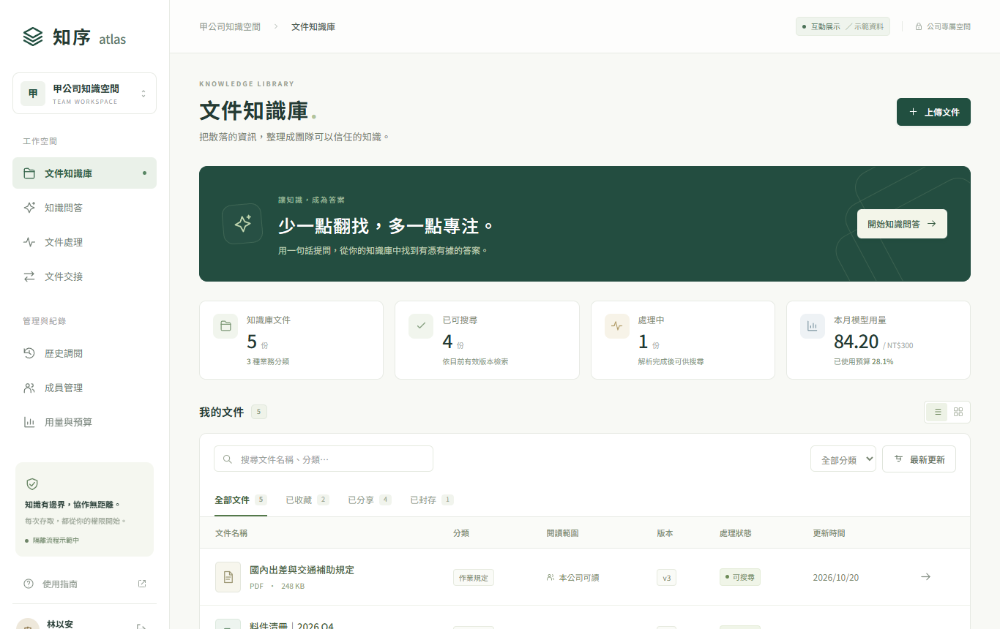
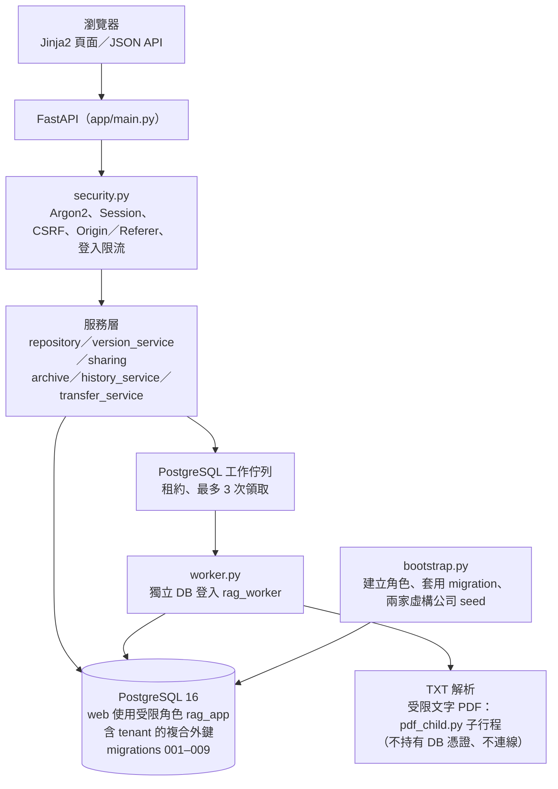

# Secure Multi-Tenant RAG

多家公司共用、依「公司＋文件權限」嚴格隔離的知識文件平台，目標是在這個權限基礎上提供帶來源引用的 RAG 問答。

> **現況說明（請先讀）**
>
> - **`main` 目前沒有 RAG、也沒有資料庫 RLS。** `main` 是多租戶文件權限平台：登入安全、文件版本、分享／撤權、封存、歷史調閱、檔案交接，以及 TXT／受限文字 PDF 的背景處理。隔離目前靠 API 層 SQL 條件與含 tenant 的複合外鍵。
> - **RAG 與 RLS 在未合併的分支 [`codex/milestones-1-3-handoff`](https://github.com/mina201199/secure-multi-tenant-rag/tree/codex/milestones-1-3-handoff)**，尚未整合進 `main`（見下方「分支中的 RAG 與 RLS」）。
> - 兩條分支都還沒有 Hybrid／BM25、Reranker，也沒有檢索品質評估，因此沒有任何實測的 RAG 品質分數。

## 要解決的問題

企業想用 RAG 讓員工查詢內部規定、技術手冊、料件清冊，但最難的不是「回答」，而是**不能把不該看的內容送進模型**。例如 A 公司出差補助是 NT$1,500、B 公司是 NT$3,000，A 公司員工提問時，即使 B 公司的文件語意更相近，也不能被檢索、送給模型或出現在引用裡；同公司內的私人文件、已撤權的分享、已封存的舊版也一樣。

這代表權限必須在資料層就正確，而且要能處理版本更新、撤權、帳號停用、檔案交接這些會讓「昨天可以看、今天不行」的情境。這個專案先把這層權限平台做扎實並用真實 PostgreSQL 測試，再往上接 RAG。

## Demo



- 上圖是 `main` 內建的 `/demo` 互動**介面原型**（`app/templates/demo.html`、`app/static/workspace.js`）：資料是寫在前端的虛構範例，存在瀏覽器記憶體，重新整理即還原，**不連資料庫、不呼叫模型**。畫面中的問答、用量等區塊只是介面示意，不代表後端已實作。啟動 Compose 後可在 `http://127.0.0.1:8008/demo` 開啟。
- 真正走後端權限檢查的頁面是 `/login`、`/documents`、版本／分享／交接等頁面，需依「如何執行」啟動並以 seed 帳號登入。
- 另有一個公開的靜態展示頁：[secure-rag-interview-demo](https://secure-rag-interview-demo.ruru0109lee.chatgpt.site)。它是**獨立的 mock 頁面，沒有真實後端**，不呼叫付費 AI，也不代表本專案已部署。

## 架構（`main` 實際程式）



尚未在 `main` 的部分：清洗與切塊、Embedding、向量檢索、模型回答、RLS。完整的目標架構與業務規則見 [專案決策稿](docs/secure-multi-tenant-rag-decision-draft.md)。

## 技術重點

- **資料庫層防跨租戶關聯**（`app/migrations/001_m1_core.sql` 起）：外鍵帶 `(tenant_id, id)` 複合鍵，例如主管、文件擁有者、授權對象都必須與文件同公司，應用程式寫錯也無法建立跨公司的關聯。
- **最小權限的 DB 角色**：web 只用受限角色 `rag_app`，owner 憑證只給一次性的 `setup`；worker 使用另一個專用登入，不持有 owner 憑證。
- **登入與請求安全**（`app/security.py`）：Argon2 密碼雜湊、只存 token 雜湊的 Session、HttpOnly Cookie、簽章 CSRF token、Origin／Referer 檢查、登入限流；`APP_ENV` 非 local／test 時強制 HTTPS（`app/config.py`）。
- **閱讀權與管理權分開**：主管、管理員不會自動取得文件正文或歷史版本；主管審核交接時看不到檔名、摘要或正文。
- **版本、撤權、封存的一致性**：新版處理完成才原子切換為有效版本；撤權、帳號停用在下一次請求就生效（`tests/test_auth.py`、`tests/test_history.py`）；文件封存後即使有歷史調閱權也不能讀。
- **交接（transfers）的交易設計**（`app/transfer_service.py`、migration 009）：主管核准當下重新驗證主管、接收人、版本範圍、封存與期限；移轉與稽核在同一交易提交，失敗全部回滾；固定鎖定順序，衝突時以 `NOWAIT` 回 409，避免死結。
- **背景處理可恢復**（`app/worker.py`）：PostgreSQL 佇列加租約，worker 失聯後可回收工作、最多領取 3 次，重試不產生重複版本。PDF 只接受已驗收的保守格式，在受限子行程解析。
- **測試用真實 PostgreSQL**：測試庫是 Compose 中獨立的 tmpfs `test-db`，與開發庫使用不同密碼，測試無法誤連開發資料。CI 在 GitHub Actions 以拋棄式隨機憑證跑完整測試，並另跑離線 parser 與工具測試（`.github/workflows/ci.yml`）。

## 分支中的 RAG 與 RLS（未合併）

`codex/milestones-1-3-handoff` 分支在上述平台之上加入：

- `app/models.py`：OpenAI `text-embedding-3-small` 建向量；Responses API 以 strict JSON schema 讓模型只回傳證據來源與引句。
- `app/rag.py`：pgvector 精確 cosine 搜尋，最多 Top-5；引句必須是來源段落的連續子字串；送模型前與模型回傳後都重新驗權。
- `app/policies.sql`：以 HMAC 簽章綁定 session context，敏感資料表啟用 `FORCE ROW LEVEL SECURITY`；對應測試在 `tests/test_rls.py`。

這些程式尚未整合進 `main`，也還沒有檢索品質評估。該分支的說明與驗收紀錄見其 [README](https://github.com/mina201199/secure-multi-tenant-rag/blob/codex/milestones-1-3-handoff/README.md)。

## 成果與數字

| 項目 | 結果 | 來源 |
| --- | --- | --- |
| PostgreSQL 完整回歸（`main`） | 481 passed、120 subtests passed | 2026-10-21 紀錄，[docs/document-transfers.md](docs/document-transfers.md)；2026-10-30 本機 Docker 無法使用，未重跑 |
| 離線 parser 原型測試 | 26 tests OK | 2026-10-30 本機執行 `tools/ci/run_tests.py unittest prototypes/parsing/tests`（`pypdf==6.10.0`、`reportlab==4.4.9`） |
| 工具測試 | 12 tests OK | 2026-10-30 本機執行 `python -m unittest tools.test_check_rls_readiness tools.ci.test_run_tests` |
| 題庫 fixture 完整性 | 10 passed | 2026-10-30 本機執行 `pytest evals/tests` |
| 資料庫 migration | 9 支（001–009） | `app/migrations/` |

`evals/core_questions.json` 有 30 題核心題庫草案，由 AI 撰寫，人工簽核欄位仍空白，尚未用於任何評估。

## 如何執行

需要 Git、Docker 與 Docker Compose；不需要 OpenAI 金鑰。

```powershell
Copy-Item .env.example .env
# 打開 .env，把每個 change-me 換成隨機值（只用英文字母與數字，APP_CSRF_SECRET 至少 32 字元）
python -c "import secrets; print(secrets.token_hex(24))"

docker compose up --build -d
docker compose ps        # setup 應為 Exited (0)，web 應為 healthy
```

開啟 `http://127.0.0.1:8008/login`。seed 會建立兩家虛構公司（`a.` 開頭為甲公司、`b.` 開頭為乙公司），密碼都是 `.env` 的 `SEED_USER_PASSWORD`：

| 帳號後綴 | 角色 / 關係 | 可看到的文件 |
| --- | --- | --- |
| `owner` | 一般員工，三份文件的擁有者 | 出差補助規定、料件清冊（試行）、主管會議紀錄 |
| `reader` | 一般員工，獲授權閱讀料件清冊 | 出差補助規定、料件清冊（試行） |
| `staff` | 一般員工，未獲任何授權 | 出差補助規定 |
| `manager` | 上述三人的直屬主管 | 出差補助規定（主管不自動取得閱讀權） |
| `admin` | 公司管理員 | 出差補助規定（管理員不自動取得閱讀權） |
| `inactive` | 已停用 | 無法登入 |

需要 TXT／PDF 自動處理時，先在 `.env` 設定 `WORKER_DB_PASSWORD` 並重跑 setup，再執行 `docker compose --profile worker up -d --no-deps worker`（見 [worker 說明](docs/txt-worker.md)）。

自動化測試（只連 Compose 內獨立的 `test-db`）：

```powershell
docker compose --profile test run --build --rm tests
docker compose --profile test down
```

`docker compose down -v` 會刪除本機資料庫的所有資料，只在確定要重設時使用。

## 已知限制與下一步

- `main` 沒有 RLS，隔離靠 API 層 SQL 條件與複合外鍵；已建立的權限測試不能取代 RLS 驗收。
- `main` 沒有 RAG、Embedding、向量檢索或模型呼叫；分支中的 RAG 沒有 Hybrid／Reranker，也沒有檢索品質評估。
- PDF 只支援已驗收的保守文字格式（[說明](docs/pdf-processing.md)），沒有 OCR 或任意版面解析；PDF 子行程的資源限制使用 Linux 專屬 API，預期在容器內執行。
- migration 是自製的「依檔名套用 SQL」機制，尚未採用正式 migration 工具。
- 帳號啟停管理頁尚未完成。
- 早期的 [RLS 設計](docs/m2-rls-design.md) 與 [實作計畫](docs/rls-implementation-plan.md) 部分描述已過時，實作前需對照 migrations 001–009。
- 30 題核心題庫尚未人工簽核。

下一步依序為：帳號啟停 → 在 `main` 實作並測試 RLS（含 worker、歷史、交接情境）→ 合併分支中的 RAG，並加上付費呼叫前的預算預留（每月上限 NT$300）→ 人工簽核題庫後做檢索與回答評估，未授權存取成功次數必須為 0。

## 我負責的部分

本專案由我獨立完成，涵蓋需求與權限規則定義、資料庫與系統設計、實作、測試、CI／Docker 與文件。

## 延伸文件

[專案決策稿](docs/secure-multi-tenant-rag-decision-draft.md) · [交接](docs/document-transfers.md) · [歷史調閱](docs/history-access.md) · [封存](docs/document-archive.md) · [PDF 處理](docs/pdf-processing.md) · [TXT worker](docs/txt-worker.md) · [CI](docs/ci.md) · [相依套件授權](docs/dependency-licenses.md)

## 授權

程式碼以 [MIT License](LICENSE) 授權。
