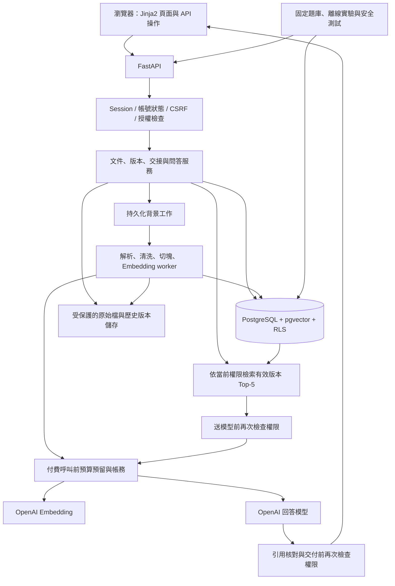

# Secure Multi-Tenant RAG

提供多家公司共用、依公司與文件權限隔離的繁體中文知識查詢平台。處理作業規定、技令手冊、料件清冊等知識資料，完成盤點、解析、清洗、切塊、向量化、檢索及帶來源引用的回答，並用實驗與安全測試驗證結果。

**交接日期：2026-10-20。目前是第一階段的程式骨架，尚未完成可執行服務，也沒有通過功能或安全驗收。** 本 README 是組員接手入口；完整業務決策與取捨見 [專案決策稿](docs/secure-multi-tenant-rag-decision-draft.md)。決策稿記錄規劃當時的狀態，實作進度以本 README 與實際測試報告為準。

**組員認領入口：[GitHub 任務總索引 #1](https://github.com/mina201199/secure-multi-tenant-rag/issues/1)**。67 項未完成編號任務已各自建立 Issue，依 7 個階段的 [Milestones](https://github.com/mina201199/secure-multi-tenant-rag/milestones) 與 `phase:*` 標籤分類。每項包含前置任務、完成條件與認領方式；請先看索引的起步建議，留言認領並由 Assignees 追蹤負責人。功能驗收後再關閉 Issue，並同步更新本文件勾選狀態。

## 目錄

- [目前進度與接手順序](#目前進度與接手順序)
- [目標與第一版範圍](#目標與第一版範圍)
- [架構與資料流](#架構與資料流)
- [技術框架與相依套件](#技術框架與相依套件)
- [目前目錄與已知啟動缺口](#目前目錄與已知啟動缺口)
- [環境與啟動方式](#環境與啟動方式)
- [必須遵守的權限與業務規則](#必須遵守的權限與業務規則)
- [資料模型與資料庫設計任務](#資料模型與資料庫設計任務)
- [預計的 API 與頁面契約](#預計的-api-與頁面契約)
- [完整開發任務清單](#完整開發任務清單)
- [測試與驗收](#測試與驗收)
- [分工與協作方式](#分工與協作方式)
- [後續擴充與未定細節](#後續擴充與未定細節)
- [最終交付清單](#最終交付清單)

## 目前進度與接手順序

`[x]` 僅表示文件或程式已存在；不表示功能已通過驗收。未經執行驗證的模組均須由接手者測試。

| 區塊 | 現況 | 接手者應做的事 |
| --- | --- | --- |
| 需求與架構決策 | 已完成決策稿 | 先閱讀權限、版本、交接及預算限制 |
| Docker / Compose | 已有配置，未完成啟動驗證 | 補齊入口、初始化及測試目錄後建置 |
| `app/config.py` | 已有環境設定與基本檢查 | 與啟動流程整合並測試 |
| `app/db.py` | 已有 psycopg 連線與 request 交易依賴 | 確認交易與錯誤回滾行為 |
| `app/security.py` | 已有密碼驗證、Session、CSRF、登入限流等函式 | 接上路由、資料表與頁面，驗證行為 |
| `app/repository.py` | 已有帶 tenant 與閱讀條件的 SQL 查詢 | 補資料表、API 與越權案例；尚無 RLS |
| API / HTML 頁面 | 尚未建立 | 補 `app/main.py`、路由與 Jinja2 範本 |
| 初始化 / 測試帳號 | 尚未建立 | 補 `app/bootstrap.py`、schema 與兩家公司 seed |
| 自動化測試 | 尚未建立 | 補 `tests/`，建立 API 與資料庫驗收 |
| 白話教學 | 尚未建立獨立教學檔 | 每階段補操作步驟、設計解釋與練習 |
| 文件生命週期 / RLS / RAG / 評估 | 尚未實作 | 依下方四個階段完成 |

**第一個可以驗收的目標：兩家公司的預建帳號各自登入後，只能列出及開啟自己有權閱讀的文件；直接呼叫 API 或猜測 ID 也不能越權。**

建議接手順序：先補資料庫 schema 與 seed → 接上登入、登出與身分驗證 → 補文件清單與內容 API / 頁面 → 完成第一階段測試 → 補教學。第一階段通過後，再進入版本、交接與 RLS，最後才接付費模型。

## 目標與第一版範圍

例：A 公司有出差補助 NT$1,500 的規定，B 公司有 NT$3,000 的規定。A 公司員工提問時，只能搜尋 A 公司內自己有權讀取的資料。即使 B 公司文件更相近，也不能把 B 公司內容送給模型或 Reranker。

第一版約定：

- 本機執行；使用兩家虛構公司的繁體中文文件與預建帳號，不用真實企業機密。
- 輸入格式為文字型 PDF 與 UTF-8 TXT；料件清冊先使用能可靠保留料號、品名、規格及單位關係的文字範例。
- 同一帳號只屬於一家公司，沒有公司切換與公開註冊。
- 單輪問答，每次重新驗證權限並檢索；不帶入前文、不串流、不共用答案快取、不提供可重開的聊天紀錄。
- 平台程式以可開源為目標；第一版 Embedding 與回答使用 OpenAI API，並非全部離線或模型本身開源。正式開源前須決定 LICENSE。
- 每月外部服務預算上限 NT$300，接近上限停止付費功能，不自動增加預算。
- 每週約投入 6–8 小時，依里程碑驗收，不預設固定完成日期。

## 架構與資料流

以下是**目標架構**。目前只有設定、連線、安全函式與部分文件查詢；圖中的 Web、worker、RLS、檔案處理及模型整合仍待完成。



### 問答流程

1. Session 找出有效帳號、公司與目前角色；公司歸屬來自後端資料。
2. 在目前有效、已處理完成、未封存且有權閱讀的版本中進行檢索。
3. 起始基準用精確向量搜尋取最多 5 段，段落不足就回傳實際數量。
4. 送模型前再驗證授權，僅將已授權段落與必要問題內容送出。
5. 模型依證據回答，證據不足就拒答；文件內的指令不能改變平台權限。
6. 核對引用存在性、來源位置、授權與支持度；交付前再次檢查權限及版本狀態。
7. 交付前若帳號、授權或版本已失效，捨棄回答，不交付內容。

### 文件處理流程

上傳驗證及歸屬確認 → 保存原始版本與指紋 → 解析 → 清洗及品質檢查 → 固定 token 切塊 → Embedding → 保存段落及向量 → 完整性確認 → 原子切換有效版本。

處理狀態須可辨識「排隊、處理中、可搜尋、失敗、封存」。未完成或失敗的文件不能部分進入一般搜尋；重試與重啟不能建立重複段落、重複向量或無限制重複付費。

## 技術框架與相依套件

| 層次 | 決定 / 現有設定 | 實作狀態 |
| --- | --- | --- |
| 語言與執行環境 | Python；Docker 基底 `python:3.12-slim` | 已有 Dockerfile |
| Web / API | FastAPI + Uvicorn | 已列相依；尚無應用入口 |
| HTML | Jinja2，同一個 FastAPI 服務提供頁面 | 已列相依；範本未建立 |
| 表單 / 上傳 | python-multipart | 已列相依；路由未建立 |
| 資料庫 | PostgreSQL 16 | Compose 已選映像；schema 未建立 |
| 向量資料庫 | pgvector；`pgvector/pgvector:pg16` | 映像已設定；extension 與向量表未建立 |
| DB 存取 | psycopg 3 + 明確 SQL；目前無 ORM | 已有部分連線與查詢 |
| 登入與密碼 | 隨機 Session token + HttpOnly Cookie；Argon2 密碼雜湊 | 已有函式；端到端流程未完成 |
| 隔離 | API 授權 + PostgreSQL RLS + 關聯約束 | 僅有部分 API 查詢條件，RLS 未實作 |
| Embedding | 決策採 `text-embedding-3-small` | 尚未整合 SDK / API |
| 回答 | 決策採 `gpt-5.4-mini` | 尚未整合 SDK / API |
| 解析 / tokenizer | 必須保留來源位置與 token 計數 | 具體套件尚待選定 |
| 背景工作 | 持久化工作、可重試、可恢復、可信 tenant 情境 | 機制與 worker 尚待實作 |
| 測試 | pytest + HTTPX；真實 PostgreSQL 驗證 RLS | 已列相依，測試尚未建立 |
| 本機編排 | Docker Compose；web 綁定 `127.0.0.1:8008` | 配置已存在，未通過啟動驗收 |

實際版本範圍以 [requirements.txt](requirements.txt) 為準。目前使用版本範圍，尚無鎖定檔；接手時記錄通過驗收的確切版本。沒有既定 React、LangChain、LangGraph、Redis 或 Celery 依賴；如需新增，先說明必要性並更新架構決策。Hybrid、Reranker、第二個 Embedding 模型在對應實驗前選定與記錄。

## 目前目錄與已知啟動缺口

```text
.
├── README.md
├── docs/
│   └── secure-multi-tenant-rag-decision-draft.md
├── app/
│   ├── __init__.py
│   ├── config.py       # 環境設定與基本安全檢查
│   ├── db.py           # psycopg 連線 / request 交易
│   ├── security.py     # 密碼、Session、CSRF、登入限流函式
│   └── repository.py   # tenant 與閱讀權限 SQL 條件
├── compose.yaml
├── Dockerfile
├── requirements.txt
├── .dockerignore
├── .gitattributes
└── .gitignore
```

已知缺口：

- Dockerfile 的 `COPY tests ./tests` 指向尚不存在的 `tests/`，因此目前不能完成正常建置。
- Dockerfile 的 `uvicorn app.main:app` 尚無對應的 `app/main.py`。
- Compose `setup` 的 `python -m app.bootstrap` 尚無對應模組。
- SQL 參照的 `app_core` schema 與資料表尚無建立腳本。
- 尚無 HTML 範本、seed 帳號、可操作的登入流程、測試或獨立教學檔。

建議後續按責任拆分 `routers/`、`services/`、`templates/`、`workers/`、資料庫遷移、`tests/`、`evals/` 與教學文件；這些都是待新增的模組，不是現有目錄。

## 環境與啟動方式

前置條件：Git、支援 Linux containers 的 Docker 與 Docker Compose。本專案初期不需 OpenAI 金鑰；先完成登入與隔離驗收再接模型。

### 現在可執行的配置檢查

```powershell
docker compose config --quiet
```

這只檢查 Compose 配置，不能證明映像能建置、API 能啟動或權限正確。

### 補齊第一階段之後的預定操作

以下是待驗收的目標指令，目前缺少上述模組，**不能把它當成已可運作的快速啟動流程**：

```powershell
docker compose up --build -d
docker compose ps
docker compose logs setup web
```

預定服務為 `http://127.0.0.1:8008`；`/health`、`/docs` 與登入頁須由第一階段實作。測試帳號及密碼須隨 seed 與教學補上，目前尚無可用帳密。

預定自動化驗收指令：

```powershell
docker compose --profile test run --build --rm tests
docker compose down
```

目前 Compose 分開使用 `db` / `test-db`，測試資料庫為 tmpfs，測試不能連線開發或正式資料庫。`down` 不移除命名資料卷；資料重設方式須在教學另行說明。

### 現有環境設定

| 變數 | 用途 / 現況 |
| --- | --- |
| `DATABASE_URL` | web 與測試的 runtime 連線；使用 `rag_app`，不能用資料庫 owner |
| `DATABASE_ADMIN_URL` | 僅初始化及指定測試使用，不能提供給 web |
| `RUNTIME_DB_PASSWORD` | 初始化 runtime 角色時使用；初始化程式尚未建立 |
| `APP_BASE_URL` | 本機設定為 `http://127.0.0.1:8008`，供 Origin / CSRF 驗證 |
| `APP_CSRF_SECRET` | 簽章密鑰；程式要求至少 32 字元 |
| `APP_ENV` | 現有環境分為 local / test；其他環境要求 HTTPS 及 Secure Cookie |
| `COOKIE_SECURE` | 本機 HTTP 為 false；非本機環境須 true |

現有 Session 設定是閒置 30 分鐘、最長 8 小時；登入 CSRF 有效 10 分鐘，登入限制以帳號與來源位址組合計數，每 10 分鐘超過 10 次回傳 429。這些是已寫入程式的初值，尚待驗證，且目前不是可由環境變數全部覆寫的設定。

Compose 中的 `local-*` 與資料庫密碼均為本機教學占位值。正式環境需替換並另行部署設計。`.env` 目前不會自動覆蓋 Compose 裡的固定字串，若改採環境變數插值，必須同步更新 Compose 與提供不含真實密鑰的範例。未來 OpenAI 金鑰僅由後端或 worker 取得，不提交 Git、不放前端。

## 必須遵守的權限與業務規則

### 身分與閱讀權

- `tenant_id` 必須從可信 Session 與後端資料推導；使用者傳入的 ID 不能直接當作授權依據。
- 每次請求檢查帳號是否有效、Session 是否有效、公司、文件狀態與授權；停用帳號或撤銷授權從下一次請求生效。
- 新文件上傳者為擁有者，預設私人；擁有者可設本公司可讀或授權同公司有效帳號。
- 角色只有公司管理員與一般員工；主管是固定直屬關係，擁有者是文件 / 版本責任關係。
- 公司管理員只能啟用、停用本公司的預建帳號；不能讀取全部文件、冒用身分、重設他人密碼、提升角色、修改公司或主管關係。
- 主管不自動獲得檔名、摘要、文件內容、搜尋或歷史調閱權。
- 未授權者不能透過清單、ID、錯誤、摘要、引用或下載得知文件存在或內容。
- 模型不負責授權、不持有 DB 憑證、不執行任意 SQL、不依文件指令開啟外部網址。

### 版本、封存與歷史

- 更新建立新版本，原始內容與所有舊版本保留；不能覆寫舊版。
- 只有目前擁有者能新增版本；新版預設私人，不複製舊閱讀授權。
- 新版處理中或失敗時，舊的有效版本繼續使用。
- 新版成功取代舊版後，前台只使用新版；無新版權限者不能回退舊版。
- 封存取代一般刪除；保留原始檔、文字、段落、向量與紀錄，退出前台開啟、搜尋及下載。
- 背景重試不能重新啟用已封存文件；舊答案引用不能繞過封存或版本規則。
- 歷史調閱是獨立授權，由該版本擁有者授予同公司帳號；新版閱讀權、管理員或主管身分都不包含歷史權。
- 後台調閱要重新授權並記錄誰、何時、哪個版本。前台不提供歷史回查。

### 交接與主管審核

- 由目前擁有者提出交接範圍、涵蓋版本、候選接收人與原因，直屬主管核准後才移轉。
- 接收人須為同公司有效帳號；主管不能核准自己接收，第一版不提供上層主管例外。
- 主管只看自己待審案件的申請編號、原擁有者、接收人與原因，不顯示檔名、摘要及內容；原因不能自動夾帶內容。
- 執行核准時重新確認主管關係、帳號狀態、目前擁有者、文件狀態與申請有效性。
- 必須以交易與並行控制避免重複移轉、過期申請生效或只更新一半。
- 成功後保留既有閱讀 ACL；原擁有者失去管理權，但若仍有有效閱讀授權，可繼續閱讀。
- 不默認移轉未列入範圍的歷史版本權限。
- 未提出交接就被停用的帳號不由管理員自動接管；第一版接受文件可能無人管理的限制。

## 資料模型與資料庫設計任務

以下是邏輯模型與實作建議，**尚無完整 DDL / migration**。第一階段現有 SQL 已依賴 `app_core.tenants`、`users`、`sessions`、`login_limits`、`documents`、`document_readers`；組員需先補齊相容 schema，再以 migration 演進到版本模型。

| 邏輯資料 | 需要保存的內容與關聯 |
| --- | --- |
| tenants | 公司 ID、公司名稱 |
| users | 公司、唯一登入名稱、顯示名稱、密碼雜湊、角色、有效狀態、固定主管 |
| sessions | token 雜湊、使用者、建立 / 最後活動 / 到期時間；不存明文 token |
| login_limits | 登入計數 key 雜湊、視窗開始時間、嘗試次數 |
| documents | 公司、標題、業務分類、目前管理責任、目前有效版本、封存狀態 |
| document_versions | 文件、公司、版本 ID、版本擁有者、來源資訊、原檔指紋、處理狀態、時間 |
| document_readers / 版本閱讀 ACL | 將閱讀權綁定明確版本範圍；新版不繼承，避免文件層 ACL 自動洩漏新版 |
| history_permissions | 獨立的歷史調閱授權、授權人與接收人、版本範圍 |
| chunks / embeddings | 公司、文件與版本、原文位置、頁次 / 段落、文字、token 數、模型與向量 |
| jobs | 可信 tenant / version、處理步驟、狀態、重試、錯誤、恢復及去重資訊 |
| transfer_requests | 申請人、主管、候選接收人、文件與版本範圍、原因、狀態及審核時間 |
| audit_events | 授權、封存、版本切換、交接、停用及歷史調閱事件，避免正文與憑證 |
| usage / reservations | 呼叫模型、token、費用估算、預留 / 結算 / 釋放、延遲與失敗 |
| evaluation_runs | 題庫 / 文件 / 模型版本、設定、結果與報告位置；完整虛構資料結果獨立保存 |

資料庫要求：

- tenant 相關資料具可信 `tenant_id`；複合唯一鍵 / 外鍵防止跨公司 ACL、版本、段落、工作與主管關係。
- 段落與向量必須指向正確版本，文件的有效版本不能指向另一文件或另一公司。
- 管理初始化角色與 runtime / worker 角色分離；runtime 與 worker 不得是 superuser、BYPASSRLS 或可任意繞過政策的 owner。
- 文件、版本、段落、向量、授權及工作等資料須依用途設計 RLS；讀寫都要測試，不能只測 SELECT。
- 每個 request / 工作設定可信租戶與使用者情境，以交易範圍管理；連線重用不能沿用上一公司的身分。
- RLS 與 API 授權並存；RLS 不能取代資料關聯約束與業務流程驗證。
- 初始化可重複執行且不破壞既有資料；資料庫變更要有可重現的 migration / 版本策略。

## 預計的 API 與頁面契約

以下是**待實作的介面草案**，組員可調整路徑，但須同步更新 README、測試與 OpenAPI。路由權限不能只靠隱藏按鈕。

| 模組 | 建議介面 | 規則與預期輸出 |
| --- | --- | --- |
| 健康檢查 | `GET /health` | 不洩漏憑證、內部路徑或資料內容 |
| 登入 | `GET /login`、`POST /login`、`POST /logout`、`GET /api/me` | CSRF、Session、帳號停用、限流與登出撤銷 |
| 文件閱讀 | `GET /api/documents`、`GET /api/documents/{id}` | 只回傳已授權資料；不存在與不可讀的回應不能洩漏存在性 |
| 上傳與狀態 | `POST /api/documents`、`GET /api/jobs/{id}` | 驗證格式 / 容量 / 公司，預設私人，只看自己可存取的工作 |
| 版本與重試 | `POST /api/documents/{id}/versions`、`POST /api/jobs/{id}/retry` | 目前擁有者、冪等性、預算、封存與有效版本切換 |
| 分享 | `PUT /api/documents/{id}/sharing` | 擁有者、目前版本、同公司有效帳號；拒絕跨公司 ACL |
| 封存與下載 | `POST /api/documents/{id}/archive`、`GET /api/documents/{id}/download` | 封存後退出前台；下載走授權，不暴露靜態路徑 |
| 歷史後台 | `GET /api/history/versions/{id}` 與歷史授權介面 | 獨立歷史權、版本 / 公司 / 帳號檢查、調閱稽核 |
| 交接 | `POST /api/transfers`、`GET /api/transfers`、審核 approve / reject | 申請與審核範圍、資訊最小化、自我接收禁止、交易一致性 |
| 帳號管理 | 本公司帳號啟用 / 停用介面 | 只有公司管理員；不增加角色、主管或文件權限 |
| 問答 | `POST /api/questions` | 單輪問題、授權 Top-5、答案 / 拒答、文件名與來源位置引用 |

對應 Jinja2 頁面包含登入、文件清單 / 詳細內容、上傳 / 處理狀態、版本管理、分享、問答 / 引用、交接申請 / 主管待審、歷史後台與帳號啟用停用。所有可變更狀態的 Cookie 認證操作須有 CSRF 與 Origin 檢查；GET 不執行寫入業務操作。

## 完整開發任務清單

任務可用編號建立 issue 與 PR。只有實際完成且附驗證證據的項目才勾選；若只完成子項，不將整個階段標為完成。

### M0：規劃與交接

- [x] M0-01 整理完整需求、權限與架構決策稿。
- [x] M0-02 建立初步 Docker / Compose 與 Python 相依檔。
- [x] M0-03 寫入設定、DB 連線、安全函式及初步文件授權查詢。
- [x] M0-04 建立 README：現況、架構、規則、完整任務、驗收與協作方式。
- [ ] M0-05 確定程式授權條款、相依套件授權與正式開源方式。
- [ ] M0-06 確定各模組負責人、共用 API / schema 契約與驗收證據存放規則。

### M1：API、資料庫與登入

- [ ] M1-01 建立 `app/main.py`、FastAPI app、設定載入、DB dependency、錯誤處理與 `/health`。
- [ ] M1-02 建立 `app/bootstrap.py`、`app_core` schema、必要表 / 約束、runtime 角色與初始化權限。
- [ ] M1-03 建立兩家公司 seed：管理員、主管、擁有者、獲授權與未授權員工，含固定主管關係。
- [ ] M1-04 建立私人、本公司公開與指定人員閱讀的虛構文件；兩家公司使用相近標題但不同內容。
- [ ] M1-05 接上 Argon2、登入 / 登出、Session 雜湊保存、Cookie、過期及停用帳號檢查。
- [ ] M1-06 接上登入 / Session CSRF、Origin 檢查與登入限流，確認失敗嘗試計數不因回滾消失。
- [ ] M1-07 建立目前身分、文件清單 / 詳細 API 與 Jinja2 頁面，使用可信公司與授權條件。
- [ ] M1-08 讓 owner 憑證僅出現在初始化；runtime 不持有可任意管理資料庫的憑證。
- [ ] M1-09 補齊 `tests/`；驗證正常登入、錯誤密碼、過期 / 登出、CSRF、限流、停用與越權。
- [ ] M1-10 實際完成 Compose 建置、初始化、啟動、健康檢查及 test profile 執行。
- [ ] M1-11 整理第一階段白話教學、測試帳號、操作步驟、小修改練習與驗收結果。

M1 驗收：兩家公司登入、各自可讀文件正確、猜 ID 與直接 API 無法越權，並附測試結果。此時仍須明確註記「尚無資料庫 RLS」；不能宣稱已完成多層隔離。

### M2：文件權限、版本、封存、交接與 RLS

- [ ] M2-01 設計並 migration 到文件 / 版本 / 有效版本 / 版本擁有者 / 版本 ACL 模型。
- [ ] M2-02 實作私人、本公司公開及指定同公司有效帳號分享；撤權下一次請求生效。
- [ ] M2-03 僅目前擁有者可新增版本，新版預設私人且不繼承舊 ACL。
- [ ] M2-04 新版成功前保留舊有效版；成功後原子切換，禁止未獲新版授權者回退舊版。
- [ ] M2-05 封存保留所有資料，阻止一般開啟、下載、檢索與背景工作重新啟用。
- [ ] M2-06 實作獨立歷史調閱與授權後台；檢查版本擁有者權限與完整稽核。
- [ ] M2-07 實作交接提出、待審、核准 / 拒絕、明確版本範圍與有限主管資訊。
- [ ] M2-08 核准時重查主管 / 接收人 / 擁有者 / 文件 / 申請，禁止主管自收與跨公司接收。
- [ ] M2-09 以交易及並行控制防止重複核准、過期申請與部分移轉；保留既有閱讀 ACL。
- [ ] M2-10 公司管理員僅能啟停本公司預建帳號，不能冒用、改主管、提升角色或自動接管文件。
- [ ] M2-11 加入 RLS 與必要關聯約束；區分初始化、web、worker 的最低權限角色。
- [ ] M2-12 測試 RLS 讀寫、背景工作情境、跨 tenant 關聯、連線重用、撤權與停用。
- [ ] M2-13 完成所有對應 API、頁面及直接 API 越權測試；補第二階段教學。

M2 驗收：權限、版本、歷史、封存與交接規則全部有正反案例；API 與真實 PostgreSQL RLS 都通過測試。

### M3A：資料盤點、上傳與文件處理

- [ ] M3A-01 建立資料盤點表：公司、業務分類、來源、擁有者、版本、格式、指紋、授權與處理狀態。
- [ ] M3A-02 選定文字 PDF / TXT 解析套件；定義大小、頁數、編碼與格式驗證及錯誤回應。
- [ ] M3A-03 原始檔存於受保護位置，保留版本與來源，檔名 / 儲存路徑不可成為授權手段。
- [ ] M3A-04 PDF 保留實際檔案頁次與跨頁範圍；TXT 固定該版本段落編號。
- [ ] M3A-05 清洗空白與換行並保存來源對應，不能改寫金額、日期、料號、規格與單位。
- [ ] M3A-06 檢查 PDF 閱讀順序與料件欄位關係；無法可靠解析須失敗，不能直接進索引。
- [ ] M3A-07 選定並記錄 tokenizer；起始切塊 600 tokens、重疊 60 tokens，保留原文範圍。
- [ ] M3A-08 實作持久化背景工作、狀態查詢、可恢復步驟、去重、有限重試與逾時。
- [ ] M3A-09 工作從可信資料取得公司 / 版本情境；撤權、封存與重啟不能造成越權或資料復活。
- [ ] M3A-10 保存 chunks / embeddings 及模型資訊，通過完整性確認後才允許搜尋。

### M3B：付費用量控制與模型整合

- [ ] M3B-01 整合後端模型客戶端、密鑰環境設定、逾時、限流、重試與錯誤處理。
- [ ] M3B-02 每次付費呼叫前以交易或等效機制預留最大可能費用，所有平行工作共同計帳。
- [ ] M3B-03 限制輸入、輸出、重試及工作並行數；剩餘預算不足則停止，不自動加價或換昂貴模型。
- [ ] M3B-04 保存模型、token、估計 / 實際費用、耗時、預留與結算；處理失敗與重試不重複計帳。
- [ ] M3B-05 執行前核對模型可用性與當時費率，記錄換算、稅費與誤差緩衝，月上限 NT$300。
- [ ] M3B-06 建立段落與問題 Embedding；模型 / 維度 / 正規化 / tokenizer 變更可追溯且不可混用。

### M3C：授權檢索、回答與引用

- [ ] M3C-01 精確 pgvector 搜尋僅限有效且有權版本，最多 Top-5，不以未授權段落補足。
- [ ] M3C-02 驗證 query 與所有候選段落的公司、版本、ACL、帳號有效性與處理狀態。
- [ ] M3C-03 模型前重新驗權；任何 Reranker / 外部服務只能接收已授權候選。
- [ ] M3C-04 單輪證據式回答與無充分證據拒答；不靠模型既有知識猜公司規定。
- [ ] M3C-05 防止文件 Prompt Injection 改變權限、工具、外部連線或回答規則。
- [ ] M3C-06 引用綁實際使用版本與原文位置，前台顯示授權文件名稱及 PDF 頁次 / TXT 段落。
- [ ] M3C-07 驗證引用存在、位置、授權與支持度，不接受模型捏造來源或未檢索版本。
- [ ] M3C-08 回覆前再次驗權；問答期間撤權 / 停用 / 封存 / 替換版本時拒絕交付。
- [ ] M3C-09 不串流、不共用答案快取、不帶上一輪記憶；問答與錯誤不透露未授權文件存在性。
- [ ] M3C-10 補問答 / 引用 / 處理狀態頁面與第三階段白話教學。

M3 驗收：PDF / TXT 到帶引用回答的完整流程可重現，失敗 / 重試 / 封存 / 撤權行為可測，付費呼叫具預算控制與帳務。

### M4：固定題庫、比較實驗、安全報告與作品集

- [ ] M4-01 建立 30 題人工校對核心題庫，再擴充至少 100 題自動化驗收題。
- [ ] M4-02 分開開發調參與最終驗收題，保留題庫版本，不拿最終題庫反覆調參。
- [ ] M4-03 每題保存帳號、公司、角色 / 關係、授權、版本狀態、標準答案與允許的原文證據。
- [ ] M4-04 涵蓋可回答、無答案、公司內未授權、跨公司相似規定、新舊矛盾、料件差異與惡意指令。
- [ ] M4-05 比較 300 / 600 / 1000 tokens，固定並記錄 overlap 規則，計算 Recall@5。
- [ ] M4-06 選定適合繁體中文的 Hybrid 實驗方法，與 Vector 比較 Recall@5、MRR、延遲。
- [ ] M4-07 在相同候選集合比較有 / 無 Reranker，計算 nDCG@5、額外延遲與成本。
- [ ] M4-08 選定第二個 Embedding，分別建置可追溯索引，比較正確檢索率、Recall@5、維度與費用。
- [ ] M4-09 離線比較有 / 無檢索回答，評估 Faithfulness、答案 / 引用正確率及拒答表現。
- [ ] M4-10 執行多角色、多帳號、跨公司與公司內未授權的完整隔離實驗。
- [ ] M4-11 記錄每次實驗的模型 / 資料 / 題庫版本、設定、token、費用、延遲與失敗。
- [ ] M4-12 以原文證據單位計分，避免 overlap 重複得分；無答案題與不適用指標分開報告。
- [ ] M4-13 語意評分訂明確規則並人工抽查；如使用模型評審，揭露模型、提示與人工一致性。
- [ ] M4-14 保留所有安全失敗、洩漏階段、修正與重測；已定義測試集未授權成功次數須為 0。
- [ ] M4-15 交付可重現的評估指令、真實比較報告、限制、展示流程、面試筆記與第四階段教學。

## 測試與驗收

### 必測的安全案例

| 情境 | 必須驗證的結果 |
| --- | --- |
| 偽造 tenant、猜文件 / 版本 / 工作 ID | 不取得另一公司資料或存在性資訊 |
| 同公司未獲 ACL、管理員 / 主管越權 | 不讀取私人文件、歷史資料或擅自管理 ACL |
| 撤權 / 停用 | 下一次請求拒絕；模型前與交付前再驗證 |
| 背景工作與 DB 連線重用 | 不沿用其他公司情境，不接受未驗證工作身分 |
| RLS / 外鍵 / 寫入 | runtime 無繞過權限，跨公司關聯與寫入被拒絕 |
| 新版處理失敗 / 新版私人 | 原有效版持續可用；切換後無新版權不能回退 |
| 封存 / 重試 / 舊引用 | 不透過工作或引用重新公開資料 |
| 歷史後台 | 只有獨立版本權限可讀，並留下調閱紀錄 |
| 交接自收 / 過期 / 雙重核准 | 拒絕不合法流程，原子更新，無部分轉移 |
| 惡意文件指令 | 不改授權、不洩漏、不執行任意工具 / SQL / 網址 |
| 並行付費工作與重試 | 預算預留一致，超額前拒絕，失敗可追帳 |

安全必要標準：已定義測試集中未授權存取成功次數為 **0**。檢查文件清單 / 檔名、API、檢索段落、送往模型與 Reranker 的輸入、答案、引用、下載及背景工作。未授權內容只要送入外部服務，即使最後答案沒洩漏也算失敗。

隔離承諾針對應用使用者，不涵蓋掌握主機或資料庫最高權限的平台維運者。通過有限測試不代表證明任何情況都不會洩漏。品質與延遲先建立基準並呈現真實結果，不填預想成績。

### 測試方式與證據

- 單元測試處理純邏輯，如切塊來源對應、引用核對、預算計算與權限規則。
- API 整合測試驗證 Session、CSRF、角色、版本與交接；直接呼叫 API，不只點頁面。
- 使用真實 PostgreSQL 與受限 runtime 角色驗證 RLS、交易、外鍵與連線情境，不能用 SQLite 替代。
- 模型相關一般測試使用可控替身；付費評估另行明確執行，經預算閘門。
- 每階段保留指令、環境版本、通過 / 失敗摘要、已知限制與必要畫面；失敗不得從報告中移除。
- 一般日誌不保存密碼、token、文件正文或完整問答；完整虛構題庫與評估結果獨立管理。

目前沒有任何測試通過結果。`requirements.txt` 有 pytest 不等於已完成測試；Compose 有 healthcheck 不等於服務健康。

## 分工與協作方式

以下是可認領的工作範圍，不代表已指定任何組員：

| 工作範圍 | 建議認領任務 | 依賴 / 交接產物 |
| --- | --- | --- |
| API / 登入 / 頁面 | M1、M2 對應介面 | 與 DB 組先定 schema；交付 OpenAPI、頁面與 API 測試 |
| DB / 權限 / 生命周期 | M1 schema、M2 | 交付 migration、seed、權限矩陣、RLS 與交易測試 |
| 文件 / 背景工作 | M3A | 與 DB 組定版本 / chunks / jobs 契約，交付可恢復處理流程 |
| 檢索 / 模型 / 預算 | M3B、M3C | 依 M2 授權與 M3A chunks，交付用量閘門、引用與問答 |
| 評估 / 安全 / 教學 | M4，並從 M1 起協作 | 先做虛構文件、權限矩陣與題庫，持續驗收各模組 |

協作約定：

1. 組員先閱讀 README 與決策稿，再依任務編號認領工作；不要以角色身分推定文件特權。
2. 建立功能分支，例如 `feat/m1-auth`、`feat/m2-rls` 或 `feat/m3-ingestion`，透過 PR 合併。
3. schema、ACL、有效版本與 API 契約變動先協調；若改既有業務決策，記錄理由並取得專案負責人確認。
4. 每個 PR 說明功能、涉及任務、migration、驗證指令與結果、已知限制；README 狀態同步更新。
5. 安全核心改動附正反案例，並保留失敗與修正紀錄；測試通過才勾選相應任務。
6. 每階段另寫 `docs/` 白話教學，說明做了什麼、為什麼需要、如何操作與驗證，以及一個小修改練習。
7. 金鑰、真實文件、個人憑證、DB dump 與本機資料不要提交。只使用可分享的虛構 fixture。

## 後續擴充與未定細節

### 不在第一版產品範圍

- 跨公司帳號切換、公司 / 使用者公開註冊、邀請、密碼復原。
- 動態主管、部門群組、自訂角色、主管自己接手、突然離職例外交接。
- 多輪聊天、聊天紀錄重開、前台歷史回查、串流與共用答案快取。
- 掃描 PDF / OCR、DOCX、XLSX / CSV、複雜或跨頁表格、跨語言檢索。
- 正式業務資料庫連接器、外部爬取、自動同步與正式對外部署。
- Heading / Semantic Chunking、近似向量索引與更完整的自架模型環境。

**Hybrid、Reranker、第二個 Embedding 雖不在起始基準，仍是 M4 必須完成的比較實驗，不能略過。**

### 對應實作前需記錄的決定

- PDF parser、tokenizer、原始檔儲存方式與 migration 工具。
- 持久化工作與 worker 機制、去重鍵、鎖定方式、重試與恢復策略。
- 上傳大小 / 頁數、問題長度、工作逾時、輸入 / 輸出 / 重試 / 並行上限。
- RLS 情境設定與清除、各角色授權、版本範圍 ACL 與歷史權責關係。
- Hybrid / 繁體中文斷詞、Reranker 與第二模型、實驗相關性分級與計分方法。
- 月預算換算與安全緩衝、模型可用性與費率、實際驗收環境版本。
- LICENSE、相依套件授權、CI、公開展示與部署方式。

上述細節未定，不代表可以無限制接受輸入，或略過已確定的隔離與 NT$300 預算規則。

## 最終交付清單

- [ ] 可重現的本機啟動、初始化、測試與操作文件。
- [ ] 完整 API、Jinja2 介面、schema / migration、兩家公司虛構資料與權限矩陣。
- [ ] 登入、分享、版本、封存、歷史、交接與帳號啟停的正反驗收。
- [ ] API + RLS + DB 關聯約束 + 背景工作情境的隔離驗證。
- [ ] PDF / TXT 全流程、授權 Top-5、證據回答 / 拒答及來源引用。
- [ ] NT$300 月用量控制、預留 / 結算、token / 費用 / 延遲記錄。
- [ ] 30 題核心、至少 100 題驗收、六項真實比較實驗與失敗報告。
- [ ] 四階段白話教學、練習、架構說明、展示腳本與面試問答。
- [ ] 授權條款、相依授權檢查與可分享的作品集內容。

本次交接保存的是尚未完成 M1 的開發起點。接手後先讓第一階段可運作並通過測試，再依序完成後續任務。
