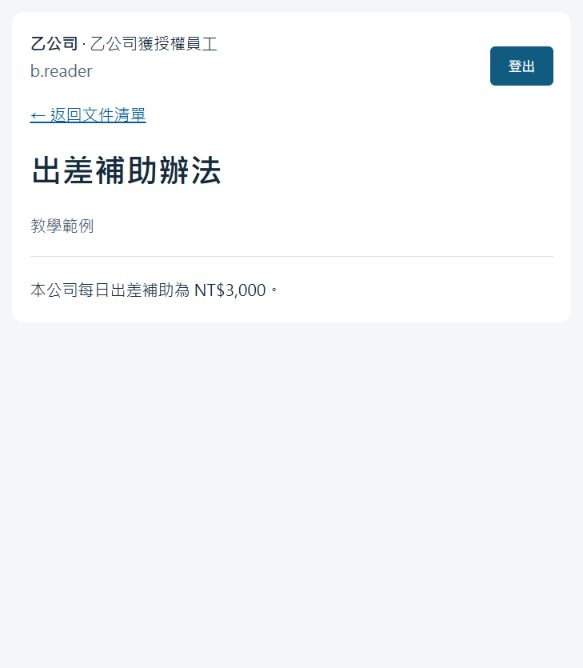

# 第一階段驗收紀錄

這是第一階段的歷史驗收結果；目前實作與最新測試見 [第二階段驗收紀錄](milestone-2-verification.md)。

驗收日期：2026-10-20（Asia/Taipei）。範圍是本機兩家公司登入、授權文件清單與內容，不包含 RLS、上傳、版本管理或 RAG。

## 結果

| 驗證 | 實際結果 |
| --- | --- |
| `docker compose config --quiet` | 成功 |
| Docker 建置 | 成功；使用 `requirements.lock.txt` 約束本次套件版本 |
| `docker compose up --build -d --wait` | 成功；後續重新部署亦通過 |
| 初始化 | `setup` Exited (0)；兩家公司、十個帳號、六份文件 |
| 服務健康 | `db`、`web` healthy；web 綁定 `127.0.0.1:8008` |
| 真實 PostgreSQL 自動化測試 | **26 passed, 1 warning in 24.22s** |
| Windows 主機實際 HTTP 驗收 | **十個帳號登入／清單／登出與 140 次文件 API／頁面檢查通過** |
| 實際瀏覽器 | a.reader、b.reader 均能登入，分別顯示自己的兩份文件；補助分別為 NT$1,500、NT$3,000；登出成功 |

可重現指令：

```powershell
docker compose --profile test run --build --rm tests
docker compose up -d --wait
powershell -NoProfile -ExecutionPolicy Bypass -File .\scripts\verify-running.ps1
```

測試最後輸出：

```text
26 passed, 1 warning in 24.22s
PASS a.admin
PASS a.supervisor
PASS a.owner
PASS a.reader
PASS a.outsider
PASS b.admin
PASS b.supervisor
PASS b.owner
PASS b.reader
PASS b.outsider
PASS health, 10 account logins/lists/logouts, 140 document API/page access checks
```

警告為 Starlette TestClient 對 `httpx` 的棄用提示。現行測試仍全部通過，沒有忽略或隱藏警告；後續升級測試相依套件時再處理。全部確切套件版本見根目錄 `requirements.lock.txt`。

## 權限矩陣

以下規則兩家公司均適用，而且永遠不能跨公司：

| 身分 | 公司公開 | 本人私人 | 指定分享 |
| --- | --- | --- | --- |
| 管理員 | 可讀 | 不可讀其他人的私人文件 | 未列入名單即不可讀 |
| 主管 | 可讀 | 不可讀其他人的私人文件 | 未列入名單即不可讀 |
| 擁有者 | 可讀 | 可讀 | 可讀自己擁有的文件 |
| reader | 可讀 | 不可讀 | 已列入名單，可讀 |
| outsider | 可讀 | 不可讀 | 不可讀 |

十種帳號組合均測試文件清單、六個既有文件 ID、無此文件 ID，以及直接 HTML 與 API 入口。未授權與不存在的文件回傳相同 404；查詢參數與偽造的 `X-Tenant-ID`、`X-User-ID` 不能覆寫 Session 身分。

## 其他已驗證行為

- 匿名、偽造 Cookie、過期及超過閒置時間的 Session 不可讀文件。
- 錯誤密碼、不存在及停用帳號回應相同，登入名稱可正規化。
- 登入與登出檢查 CSRF；拒絕外部 Origin、null Origin、過期／錯誤／Unicode 偽造 CSRF。
- 重新登入會輪替 Session；舊 token、登出 token 與另一個 Session 的 CSRF 不能重用。
- Session token 只以雜湊保存在資料庫，Cookie 包含 HttpOnly 與 SameSite=strict。
- 登入失敗次數不因 request 回滾而消失；第 11 次受到限流，視窗到期可重試。
- 停用帳號、撤銷授權及文件變成 processing／failed／archived，在下次請求生效。
- private 文件不接受殘留的指定閱讀 ACL。
- runtime 角色不是 superuser、BYPASSRLS、CREATEDB 或 CREATEROLE，不能改帳號、文件或建立資料表，也不能切換為 owner。
- 跨公司閱讀 ACL、文件 owner 及主管關聯由外鍵拒絕。
- 重跑初始化不重設帳號停用狀態或密碼，也不恢復已撤銷的 ACL。
- 一般 request 發生例外會回滾；HTML 內容自動跳脫；文件回應禁止快取。
- 猜測超過 bigint 上限的文件 ID 回傳一般 404。

## 驗證期間發現及修正

1. 初次測試因 `pytest` 執行入口未包含專案模組路徑而失敗，改為 `python -m pytest`，後續通過。
2. 檢查程式時發現 Unicode CSRF 可能造成字串比較例外，改用編碼後比較並加入案例，回傳 403。
3. 檢查初始化時發現重跑 seed 可能恢復已撤銷的指定閱讀名單，改為僅對新建公司進行 seed，加入撤權後重跑測試。
4. Windows HTTP 驗收腳本第一次因比較運算優先順序產生誤判，拆成明確字串變數後，十個帳號全部通過。
5. 實際瀏覽器登入發現 `Referrer-Policy: no-referrer` 讓表單帶上 `Origin: null`，被正確的來源檢查拒絕。改為 `same-origin` 後登入及登出成功，仍拒絕 null 與外部來源；重新跑完自動化與 HTTP 驗收。

以上驗收案例沒有觀察到未授權文件存取成功。這是已定義案例的結果，不代表完成 RLS 或可直接部署於真實企業資料環境。

## 瀏覽器驗收畫面

乙公司 reader 開啟本公司的補助規定：



## 交付與後續

第一階段操作、帳號、權限矩陣、練習與回述題見 [操作教學](milestone-1-guide.md)。README 已標示 M1-01 至 M1-11 完成；未代替作者完成教學練習或口頭回述，也未同步修改遠端 GitHub Issues。

下一階段仍需完成 RLS、版本／授權管理／封存／歷史調閱／交接及對應測試。現階段 runtime 能直接 SELECT 第一階段資料表，租戶閱讀隔離依賴經過驗證的 API 查詢；不能將此宣稱為資料庫層已完成租戶隔離。
