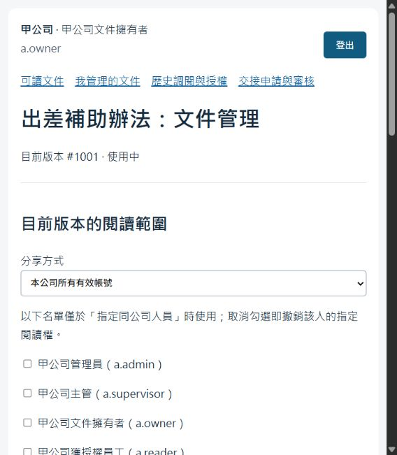
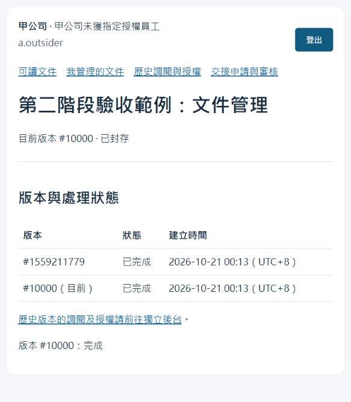

# 第二階段驗收紀錄

本頁保留 M2 的歷史結果；目前程式與測試狀態請看 [第三階段驗收紀錄](milestone-3-verification.md)。

日期：2026-10-21（Asia/Taipei）。範圍為 M2-01 至 M2-13：分享、版本、封存、歷史調閱、交接、帳號啟停、RLS、worker 情境、migration 及對應 API／頁面。

## 實測結果

| 驗證 | 結果 |
| --- | --- |
| 完整自動化回歸 | **91 passed, 1 warning in 194.66s** |
| 最後頁面調整後的表單流程重測 | **1 passed, 1 warning in 8.57s**（既有 91 項中的一項，不重複計數） |
| 第一階段實際 HTTP 回歸 | 十個帳號登入／清單／登出與 **140 次文件 API／頁面檢查通過** |
| 第二階段實際 HTTP | **57 次 HTTP 檢查通過**；使用真正 web、PostgreSQL 與背景 worker |
| 示範資料庫升級 | migration 成功，原有六份文件的 HTTP 權限矩陣仍通過 |
| Docker 啟動／重啟 | setup Exited (0)，db／web 健康，worker 持續運行；重新初始化保留封存結果 |
| 瀏覽器檢查 | 管理、分享、新版本、交接、歷史入口可見；接收人管理頁保留封存文件的兩個版本，前台不顯示該文件 |

Starlette TestClient 仍有使用 `httpx` 的棄用警告，未隱藏或忽略；不影響本次測試結果。確切 Python 相依版本沿用 `requirements.lock.txt`。

完整回歸指令：

```powershell
docker compose --profile test run --build --rm tests
```

頁面最終調整包含顯示台北時間，以及接收人選單不提供審核主管；調整後執行：

```powershell
docker compose --profile test run --build --rm tests python -m pytest -q tests/test_milestone2.py::test_pages_and_form_workflow -p no:cacheprovider
docker compose up -d --wait
```

實際 HTTP 指令：

```powershell
powershell -NoProfile -ExecutionPolicy Bypass -File .\scripts\verify-running.ps1
docker compose run --rm -T --no-deps setup python -m tests.smoke_milestone2
```

第二階段 HTTP 輸出：

```json
{
  "result": "PASS",
  "http_checks": 57,
  "document_id": 1559211779,
  "new_version_id": 10000,
  "transfer_id": 1,
  "audit_events": 12,
  "final_state": "archived"
}
```

此範例原先由 `a.owner` 管理，經 `a.supervisor` 核准移轉目前版本給 `a.outsider`，最後封存。舊版本的管理責任仍屬原擁有者，因為沒有列入交接範圍；`a.reader` 獲得明確歷史閱讀授權。驗收留下範例與稽核紀錄，不加入一般可讀文件清單。

## 權限與生命週期測試

| 主題 | 已驗證的正反案例 |
| --- | --- |
| 分享 | 私人／公司／指定人員，撤權下次請求生效；非擁有者、跨公司、停用或不存在接收人被拒絕；舊頁面的版本 ID 不能覆蓋新版分享 |
| 新版 | 僅擁有者可新增；原文不可改寫；新版私人且沒有複製 ACL；工作成功前舊版繼續可用；切換後不回退舊版 |
| 失敗與重試 | 空白內容失敗、舊版不受影響；最多三次嘗試；同文件不能重複建立未完成工作 |
| 封存 | 一般清單、API、頁面及下載拒絕存取；保留兩版原文；取消進行中工作，舊租約不能重新啟用文件 |
| 歷史 | 版本擁有者、管理員、主管或一般 reader 都沒有自動歷史閱讀權；明確授權、撤銷、跨公司與停用接收人檢查；目前版本不能以歷史入口繞過私人設定 |
| 稽核 | 每次歷史 API／頁面調閱記錄人員、時間與版本；分享、版本、交接、封存及帳號啟停留事件；普通 runtime 不可列出稽核表 |
| 交接 | 主管僅見有限資料；禁止主管自收、申請人自收、跨公司或不存在接收人；明確文件與版本範圍；保留既有閱讀名單 |
| 歷史責任移轉 | 未列入的歷史版本仍由原擁有者管理；明確列入的版本移交新擁有者，歷史閱讀名單保留 |
| 過期申請 | 擁有者、主管關係、帳號、文件狀態、版本／修訂或期限變更後核准失敗，沒有部分移轉 |
| 並行審核 | 同一申請雙重核准與兩張競爭申請均只有一次成功；多文件依固定順序鎖定，擁有者不會更新一半 |
| 帳號 | 管理員只能啟停本公司帳號；不能提交改角色欄位或自動接管文件；停用撤銷 Session，重新啟用後舊 Cookie 仍無效 |
| CSRF／頁面 | 所有新增變更 API 拒絕缺少 CSRF；完整 HTML 表單流程可操作；歷史與管理頁內容正常跳脫 |

## 資料庫與 worker 測試

- 12 張身分／業務表啟用並強制 RLS；migration 紀錄、登入雜湊計數及私有祕密各依用途另行控權。
- 以真正 `rag_app` 連線直接執行沒有 tenant 條件的 SELECT，只能取得目前身分可讀的版本與文件；管理員及主管也不能繞過私人權限。
- 沒有簽章、偽造租戶／使用者情境、修改既有簽章情境、交易提交或回滾後重用連線，都不能取得前一身分的資料。
- Session 撤銷、帳號停用與 ACL 撤銷會使後續 SQL／請求失去存取能力。
- `rag_app` 無權讀取私有簽章祕密、全部 Session 或使用者密碼欄位，不能直接新增 Session、改擁有者、改原文、切換 owner／worker 角色或停用 RLS。
- ACL 表的 INSERT 具名義 table privilege，但沒有允許寫入的 RLS 政策，正確同公司與跨公司原始 INSERT 都被拒絕；原始 UPDATE／DELETE 影響零筆。合法變更必須經受限操作函式。
- 關聯約束阻止跨公司 ACL、歷史授權、工作及錯誤有效版本；原文與雜湊的不可變觸發器連管理者一般 UPDATE 也會拒絕。
- `rag_worker` 沒有工作租約時讀不到任何版本；有效租約只能讀取單一分派版本，不能呼叫帳號／文件管理函式或改應用資料。
- worker 完成前重新檢查申請人、擁有者、文件狀態及有效版本；過期租約可恢復，新租約取代舊憑證，重複完成不會再切版。
- 帳號停用不會因 Session 活動更新持有的鎖而互相等待；認證短交易與後續業務交易分開。

## Migration 與備份

本機示範資料庫升級前已保存：

`data/before-milestone-2-20261021.sql`

這個檔案位於 Git 忽略的 `data/`，不應提交到版本庫。升級期間短暫停止舊 web，再於同一初始化交易完成結構遷移、政策、函式與授權，之後啟動新版 web／worker。

自動化升級測試另外在隔離的 `test-db` 建立一次性資料庫，寫入自訂的 M1 文件、密碼雜湊與 ACL，再連續執行兩次初始化，確認原文、帳號及名單保留且 migration 不重複套用。測試完成後刪除的只有該一次性資料庫。

## 實作期間補強

本輪已執行的自動化批次依序為 26、78、91 項，全部通過；最後頁面微調後另重測既有表單案例。沒有省略失敗案例或把尚未執行的 RAG／模型測試列為通過。

程式檢查期間另補強：

1. 將 M1 bootstrap 限定於尚未 migration 的資料庫，避免重建已退役的文件 ACL 表。
2. 將簽章身分綁定有效 Session，避免只靠可任意設定的使用者／租戶字串建立 RLS 情境。
3. 將 Session 活動更新鎖限制於認證短交易，防止與帳號停用的鎖順序衝突，並加入針對性測試。
4. worker 完成與封存／重試採相同文件優先鎖定順序，舊租約不能重新啟用封存版本。
5. 稽核表對普通 runtime 完全不開放，避免主管從自己的審核事件取得額外文件識別資料。

## 已知範圍

通過代表已定義案例中的未授權存取成功次數為 0，不代表形式證明或真實企業環境的完整安全認證。受限 `SECURITY DEFINER` 函式與持有簽章祕密的 web 是受信任程式邊界；主機／資料庫最高權限維運者不在租戶隔離承諾內。

本階段只處理貼上文字的版本，沒有 PDF 上傳、解析清洗、切塊、向量、模型、付費預算或 RAG 問答。尚不存在的第三階段資料表與工作也需要新政策及驗收。

M2-01 至 M2-13 的本機 README 已更新；遠端 GitHub Issues 未同步。作者的教學練習與口頭回述仍需自行完成。

## 瀏覽器畫面

擁有者的分享及文件管理入口：



交接接收人看到已封存範例及保留的兩個版本：


